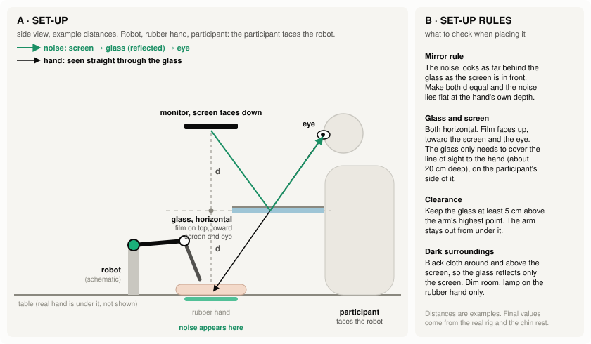

# Rubber Hand Illusion rig — specification and build roadmap

A replication of the two-arm robotic tactile stimulation setup from Chancel, Ehrsson & Ma (*eLife* 2022) and Chancel et al. (*Cortex* 2023), built on a Teensy 4.1 with a Python host.

This document is the project's single source of truth. It holds the **specification** (what must be true), the **hardware** (what we build it from), the **conventions** (how we write code), and the **roadmap** (how we get there). It is a living document — when a decision changes, the document changes with it.

---

# Part 0 — How we work

## 0.1 The shape of a step

Every step in the roadmap has five parts:

1. **Why** — the idea, in plain language, before any code exists.
2. **You'll learn** — the specific C++ or Python concept this step teaches.
3. **Build** — what to write.
4. **Acceptance** — a concrete check. Not "it compiles" but "this number is below that number".
5. **Commit** — the exact commit message.

## 0.2 Rules we hold to

- **Never skip acceptance.** A step that "probably works" becomes a bug three months later that costs a week to find.
- **Never leave `main` broken.** If a step is half-done at the end of a session, branch: `git checkout -b wip/servo-driver`.
- **One step, one commit.**
- **Ask when something isn't clear.** This document exists to be interrogated, not obeyed.

## 0.3 Code style: everything is commented

**Every line of code in this project carries a comment.** This is not normal industry practice and it is deliberate: this codebase is a teaching artefact as much as an instrument. Six months from now, you should be able to open any file and understand not just what it does but why it does it that way.

The standard we hold to:

```cpp
// ---------------------------------------------------------------------------
// Convert a desired pulse width (in microseconds) into the integer "duty"
// value that analogWrite() expects on a Teensy 4.1.
//
// Background:
//   A hobby servo is commanded by a pulse whose WIDTH encodes the angle.
//   Roughly: 1000 us = one extreme, 1500 us = centre, 2000 us = other extreme.
//   The pulse repeats at a fixed rate (the "refresh rate" or "frame rate").
//
//   The Teensy does not let us say "make a 1500 us pulse" directly. Instead we
//   choose a resolution (a number of steps, e.g. 14 bits = 16384 steps) and
//   tell it what fraction of the frame should be HIGH, expressed in steps.
//
// Worked example at 333 Hz and 14-bit resolution:
//   frame period = 1 / 333 Hz            = 3003 us
//   one step     = 3003 us / 16384       = 0.183 us
//   1500 us      = 1500 / 0.183          = 8183 steps
// ---------------------------------------------------------------------------
static uint16_t pulse_us_to_duty(float pulse_us, uint32_t pwm_hz, uint8_t bits) {
  const float frame_us = 1000000.0f / (float)pwm_hz;   // frame length in microseconds
  const float steps    = (float)(1u << bits);          // 1u << 14 == 16384 (2 to the power 14)
  const float fraction = pulse_us / frame_us;          // what share of the frame is HIGH
  return (uint16_t)(fraction * steps + 0.5f);          // scale to steps; +0.5 rounds to nearest
}
```

Three kinds of comment, all required:

- **Block comments** at the top of every function: what it does, why it exists, and a worked numeric example wherever arithmetic is involved.
- **Line comments** on any line whose meaning is not obvious from reading it. In this project, assume nothing is obvious.
- **Section banners** (`// ---- Section ----`) dividing files into readable regions.

## 0.4 Version control conventions

**Commit messages describe the change, nothing else.** They never reference this document's structure, never mention tooling used to write the code, and never carry co-author trailers. A commit message is a permanent public record of what changed in the software — that is all it should be.

Format — [Conventional Commits](https://www.conventionalcommits.org):

```
feat(firmware): add rollover-safe microsecond clock
fix(host): correct sign of asynchrony in trial builder
test: cover negative asynchrony edge case in scheduler
docs: record measured servo characteristics
refactor(firmware): extract pulse conversion into helper
chore: add build artefacts to gitignore
```

Prefixes: `feat` (new capability), `fix` (bug), `test`, `docs`, `refactor` (no behaviour change), `chore` (tooling/config), `perf`.

**Tags** mark releases, using version numbers only:

| Tag | Marks |
|---|---|
| `v0.1.0` | toolchain working, both languages building |
| `v0.2.0` | timing core verified |
| `v0.3.0` | one arm tapping and sensing |
| `v0.4.0` | calibration complete |
| `v0.5.0` | asynchrony validated ⭐ |
| `v0.6.0` | full 12 s trial |
| `v0.7.0` | experiment runnable end to end |
| `v0.8.0` | analysis pipeline validated |
| `v1.0.0` | piloted and documented |

If you use Claude Code, set attribution off before your first commit. This repository's `.claude/settings.json` already does.

## 0.5 What "modular and simple" means

Four rules. They are what stop an embedded project turning into one 2000-line `main.cpp`.

**One file, one job.** `ServoDriver` knows about pins and pulse widths and nothing else. `RobotArm` knows about movement and nothing about pins. `TrialRunner` knows about experiment structure and nothing about servos. If you can't say a file's job in one sentence, it's doing two jobs.

**Dependencies point one way.** `TrialRunner` → `RobotArm` → `ServoDriver` → hardware. Never upward. A lower layer never calls into a higher one. This is what makes each layer testable alone.

**Narrow interfaces.** `RobotArm` exposes three methods publicly. Everything else is private. A small public surface is a small thing to get wrong.

**No hidden state.** No global variables two modules both poke at. State lives inside the object that owns it.

---

# Part 1 — Experiment specification

Tags: **[P]** stated in a paper · **[D]** derived arithmetically · **[?]** unspecified, our decision.

## 1.1 Sources

| Tag | Reference | Arms | Task |
|---|---|---|---|
| **CE20** | Chancel & Ehrsson (2020), *Atten Percept Psychophys* 82:4058–4083 | 3 | 2-AFC: which of two rubber hands feels more like yours |
| **CEM22** | Chancel, Ehrsson & Ma (2022), *eLife* 11:e77221 | 2 | Yes/no: does the rubber hand feel like yours |
| **C23** | Chancel et al. (2023), *Cortex* 165:70–85 | 2 | Yes/no, with proprioceptive noise |

Robot design credited to Martti Mercurio and Marie Chancel, Ehrsson lab, Karolinska Institutet. The original control software is not described in any paper. **Our target is the two-arm design (CEM22 / C23).**

## 1.2 Original mechanics

### Our build (measured, not the paper's)

| Element | Our value | Paper |
|---|---|---|
| Proximal link | 17.5 cm long, 1.9 cm wide | 17 cm |
| Distal link | 9 cm long | 17 cm |
| Base height above floor | 17.8 cm | not stated |
| Proximal servo mount | shaft horizontal; arm swings in a vertical plane | — |
| Hand | palm down, horizontal; tip contacts top of index finger | — |

The distal link being 9 cm rather than 17 cm makes the arc-compensation
problem larger, not smaller: a shorter link curves the tip's arc more
tightly, giving about 9 mm of height variation across the finger instead of
about 4.7 mm — see §2.2.

## 1.3 Participant apparatus

| Element | Value | Src |
|---|---|---|
| Real hand | right, palm down, hidden beneath a table | [P] |
| Lateral offset from midline | 30 cm | [P] |
| Rubber hand height above real hand | 15 cm | [P] |
| Rubber hand | Fillauer cosmetic prosthetic right hand, plaster-filled | [P] |
| Occlusion | black cloth between rubber hand and body | [P] |
| Posture | chin rest + elbow rest | [P] |
| Masking | earphones with white noise, level set per participant | [P] |
| Gaze | fixate the rubber hand where it is touched | [P] |

## 1.4 Stimulation

| Parameter | Value | Src |
|---|---|---|
| Stimulation period | 12 s | [P] |
| Taps per arm per trial | 6 | [P] |
| Tap frequency | 0.5 Hz | [P] |
| Inter-tap interval | 2000 ms | [D] |
| Tap-to-tap span | 10.0 s (5 intervals) | [D] |
| Sites | 5 on the index finger | [P] |
| Site order | randomised per trial, all five used at least once | [P] |

**Sites, proximal → distal:** proximal phalanx · PIP joint · middle phalanx · DIP joint · distal phalanx just proximal to the nail.

Both arms hit the *same* site on any given tap pair — one shared sequence, not two independent ones.

## 1.5 Asynchrony

**Sign convention:** negative = rubber hand touched first; positive = real hand touched first. Implementation: `t_rubber = t_real + Δ`.

| Study | Task | Levels (ms) |
|---|---|---|
| CEM22, C23 | ownership | 0, ±150, ±300, ±500 |
| CEM22 | synchrony judgment | 0, ±50, ±150, ±300 |
| CE20 | 2-AFC | 0, ±50, ±100, ±200 |

The same Δ applies to all six taps in a trial, and applies to **contact onset**. [D]

## 1.6 Trial timeline

```
t = 0.0 s    stimulation begins — first contact pair
             6 taps per arm, 2000 ms apart
t = 10.0 s   last contact pair
t ≈ 12.0 s   robots stop; tone 1 → verbal "yes"/"no"
   +5.0 s    participant wiggles right fingers, relaxes gaze; tone 2
   +1.0 s    next trial
```

Every 5 trials, the participant is reminded to focus on the rubber hand. The finger wiggle is not filler — moving the real hand while the rubber hand stays still abolishes the illusion, so it is the reset between trials.

## 1.7 Design

| | CEM22 (visual noise) | C23 (proprioceptive noise) |
|---|---|---|
| Factors | 7 asynchronies × 3 noise levels | 7 asynchronies × 2 noise levels |
| Repetitions | 12 | 16 |
| Total | 252 per task | 224 |
| Blocks | 3 per task, ~13 min | 4, ~15 min |
| Order | pseudorandom, **no condition more than twice in a row** | pseudorandom |

Participants are not told how many asynchrony levels exist and receive no feedback.

## 1.8 Visual noise — our implementation (beam splitter; projector as fallback)

**This is a deliberate departure from the original and must be treated as one.** CEM22 used a Meta2 AR headset: the participant looked at the world *through a display*, and the software turned individual pixels of that display opaque white. We reflect a monitor in a half-silvered plate (a *beam splitter*) placed between the participant's eyes and the rubber hand, so the participant sees the hand through the plate and the noise reflected in it. The Acer C120 projector, which *adds light onto* the physical scene instead, is kept as a fallback. The change from the projector to the beam splitter was decided on 2026-11-22, before any projector measurement, because it avoids the shadow confound and the USB display link (see below).

### The original manipulation

| Element | CEM22 |
|---|---|
| Device | Meta2 AR headset, 90° FOV, 2560×1440, 60 Hz |
| Mechanism | each pixel independently turns **opaque white** frame-to-frame with probability *p* |
| Update rate | 30 frames/s |
| Levels | *p* = 0, 0.30, 0.50 |

A caution on the table above: the Meta 2 is, to our understanding, an optical see-through headset, so its pixels also *add* light rather than block it. If so, "opaque white" is shorthand for "bright enough to hide the scene". Check this against the CEM22 methods before a write-up states it either way.

### What we are building (primary)

| Element | Choice |
|---|---|
| Display | CUIUIC 15.6" IPS portable monitor, 1920 × 1080, 60 Hz, mini HDMI. Listed 400 cd/m² — to be measured |
| Beam splitter | 3 mm clear cast acrylic plate (A3, 297 × 420 mm) with a rabbitgoo silver window film on the top face. The listing states 26 % visible-light transmission; reflectance is not stated and must be measured |
| Host | the experiment laptop, driving the monitor as a second display |
| Geometry | The participant sits at the hand's side of the table, facing the robot, and looks down at the rubber hand. A horizontal glass plate sits above the hand on the participant's side, film side up. The monitor lies horizontally above the glass with its screen facing down. The *mirror rule*: the noise appears as far behind the glass as the screen is in front, so with the glass and the screen both horizontal the noise lies flat at the hand's own depth when screen-to-glass equals glass-to-hand. Example: glass 30 cm above the table, screen 60 cm, eye about 57 cm high and 40 cm from the hand; the line of sight to the hand crosses the glass about 21 cm from the hand. Real values come from the rig and the chin-rest height |



Why this and not the projector:

- **Same optics class as an AR headset.** The noise is added in the line of sight, and every white pixel is equally bright whatever surface lies behind it. With a projector, the noise on the black cloth would be dimmer than on the pale hand.
- **No shadow confound.** Nothing shines onto the scene, so the arm casts no moving shadow in the noise.
- **A normal display link.** A plain HDMI monitor at 60 Hz replaces the USB display link. The delivered noise rate is still measured, not assumed.
- **Depth.** With the mirror rule the noise can be placed at the rubber hand's depth.

What it costs, and what must be measured:

- **A dimmer, tinted view of the hand.** With 26 % transmission the hand looks about four times darker than through a 70 % plate, so the rubber hand needs its own lamp and the room must be dim. Estimate (not measured): noise 110–140 cd/m² against a hand of about 8 cd/m² under normal room light, a ratio of 13–17, which is far more than needed and is turned down at the screen.
- **A thin plate can ripple, and a second reflection can ghost.** 3 mm cast acrylic on a rigid frame should be flat enough for random noise; check by eye and by photograph.
- **The glass also reflects anything bright near the screen.** Keep black cloth around the screen so the glass reflects only the screen.
- **Clearance.** The glass only has to cover the line of sight to the hand (about 20 cm deep) on the participant's side, so the arm normally swings out from under it. Keep the glass at least 5 cm above the highest point of the arm's swing anyway.
- **The noise levels still do not transfer.** *p* = 0.30 on a Meta2 does not mean the same here; calibrate (Steps 6.7–6.8).

### Fallback: the Acer C120 projector

| Element | Acer C120 |
|---|---|
| Type | DLP, LED light source, discontinued |
| Native resolution | 854 × 480 (WVGA) |
| Brightness | 100 ANSI lumens on mains adapter; ~75 lumens on USB 3.0 power alone |
| Contrast | 1000:1 |
| Connection | **USB only** — no HDMI, no VGA. Appears to the computer as a second display |

### The four things the projector changes (fallback only)

**1. Additive, not occlusive.** The headset could make a pixel opaque — the rubber hand simply disappeared behind white. A projector can only *add* white light on top of the hand. Whether that washes out the hand's detail depends on the ratio of projected light to ambient light. In a normally lit room, 100 lumens spread over a tabletop is barely visible. **This requires a dark room**, and the ambient level becomes an experimental parameter you must control and report.

**2. Shadows.** The robot arm sits between the projector and the hand, so it casts a shadow. That shadow *moves when the arm moves* — which means the noise field itself could carry information about tap timing. This would be a direct confound: the participant might read tap timing from the shadow rather than from the touch. Two mitigations, and you should do both:

- Mount the projector as close as possible to the participant's line of sight, so the shadow falls largely behind the arm and is hidden by it.
- Verify empirically: record the projection with a camera during a trial and check whether tap onsets are visible in the noise field.

**3. USB display latency.** Reviewers of this projector noted that, depending on the laptop, it may not be able to show video at all, making it strictly a data-projection tool. Full-field pixel noise is the worst possible content for a USB display link: every pixel changes every frame, so nothing compresses. **The achievable noise frame rate must be measured, not assumed.**

**4. The noise levels do not transfer.** *p* = 0.30 on a Meta2 does not mean the same thing as *p* = 0.30 on a projector. The CEM22 values are meaningless for our device. We must calibrate our own levels — see below.

### What we do about it

Three additions to the roadmap (Steps 6.6–6.8), each producing a number that goes in the methods section:

| Step | Measures | Method |
|---|---|---|
| Frame rate | actual noise update rate delivered | Photodiode aimed at the screen (or the projection), read by the Teensy — timestamped on the *same clock* as the taps, so we can also verify noise and taps are uncorrelated |
| Optical effect | how much the noise degrades visibility | Photograph the rubber hand through the glass at each level with fixed camera settings; compute image contrast (RMS or Michelson) against the *p* = 0 baseline; report in physical units |
| Behavioural equivalence | whether our levels produce a comparable effect | Short pilot: measure discrimination at several *p*, pick levels spanning a similar range of behavioural change to CEM22 |

Recorded as deviation **D5**. The honest framing in a write-up is: *"visual uncertainty was manipulated by adding dynamic white-pixel noise to the view of the rubber hand, through a beam splitter that reflected a monitor; because the optical mechanism differs from the head-mounted display used previously, noise levels were calibrated to produce a comparable range of visual degradation, quantified as [measured contrast reduction]."*

### Proprioceptive noise (C23) — for later

28 mm vibration motors (Precision Microdrive 328-400) on the right biceps and triceps tendons, 20 Hz, on immediately before stimulation and off at trial end. Co-vibrating antagonists at matched frequency masks spindle discharge without producing a felt movement. **These are a fine use for the PCA9685** — they need no timing precision at all.

## 1.9 Screening

12 s of manual synchronous stroking with two 7 mm plastic probes, ~1 cm strokes lasting 1 s, 0.5 Hz, five points along the index finger, geometry as in the main experiment. Then a questionnaire adapted from Botvinick & Cohen (1998), rated −3 to +3. Session ~30 min.

**Inclusion criteria:** (1) mean of Q1–Q3 > 1, and (2) mean(illusion) − mean(control) > 1.

Non-inclusion rates in the original studies: roughly 20–25%.

**Illusion items**
- Q1 — It seemed as if I were feeling the touch in the location where I saw the rubber hand touched.
- Q2 — It seemed as though the touch I felt was caused by the stick touching the rubber hand.
- Q3 — I felt as if the rubber hand were my hand.

**Control items**
- Q4 — It felt as if my (real) hand were drifting upwards (towards the rubber hand).
- Q5 — It seemed as if I might have more than one left hand or arm.
- Q6 — It seemed as if the touch I was feeling came from somewhere between my own hand and the rubber hand.
- Q7 — It felt as if my (real) hand was turning 'rubbery'.
- Q8 — It appeared (visually) as if the rubber hand were drifting towards my hand.
- Q9 — The rubber hand began to resemble my own (real) hand, in terms of shape, skin tone, freckles or some other visual feature.

⚠️ **Two inconsistencies to resolve.** The main texts of CE20 and CEM22 describe three illusion and *four* control items; the CEM22 supplementary lists nine (3 + 6). And Q5 asks about a *left* hand in a right-hand study — almost certainly a leftover from an earlier version. Pick an item set, fix the laterality, record both in the deviation register.

## 1.10 Timing performance target

CE20 instrumented its arms with fibre-optic sensors and reported the difference between registered and programmed asynchrony as **11 ± 8 ms**, judging that acceptable against steps of 50/100/200 ms.

Our smallest step is 150 ms, which is more forgiving. **Acceptance target:**

- Bias ≤ 15 ms at every asynchrony level
- SD ≤ 15 ms at every level
- No drift across a 100-trial run
- The seven achieved distributions visibly non-overlapping

We are not obliged to use fibre-optic detectors. What is not optional is *having a contact measurement*. Without it we cannot state achieved asynchrony, and the manipulation is an assertion rather than a result.

## 1.11 Analysis

Proportion of "yes" per asynchrony per noise condition; two-way repeated-measures ANOVA; paired *t*-test on overall "yes" rate for the noise main effect.

**Bayesian causal inference model**, fitted per participant by maximum likelihood.

- CEM22 free parameters: `p_same`, `σ₀`, `σ₃₀`, `σ₅₀`, `σ_s`, `λ`
- C23 free parameters (5): `p_same,no-noise`, `p_same,noise`, `σ_no-noise`, `σ_noise`, `λ`
- `σ_s` fixed at 348 ms in C23 — the actual SD of the asynchronies used
- Optimizer: BADS (Acerbi & Ma 2017), 100 random starts per participant

**Bounds (CEM22 Appendix 1—table 1)**

| Parameter | Type | Hard | Plausible |
|---|---|---|---|
| `p_same` | probability | (0, 1) | (0.3, 0.7) |
| `σ` | sensory noise, log | (−∞, +∞) | (−3, 9) |
| `λ` | lapse | (0, 1) | (eps, 0.2) |
| `k₀` | asynchrony, log | (−∞, +∞) | (−3, 9) |

Goodness of fit: Nagelkerke R², normalised by its maximum. Model comparison: AIC and BIC summed across participants, 95% CIs from 10 000 bootstrap resamples.

**Published data:** CEM22 https://osf.io/zu2h6/ · C23 https://osf.io/qjf5h

Download these early. Fitting our analysis pipeline to *their* responses validates the modelling code before our hardware exists, separating "is my model right" from "is my rig right".

## 1.12 Unspecified — our decisions

| # | Parameter | Status |
|---|---|---|
| U1 | Contact force / indentation depth | Open — measure with a kitchen scale, report in newtons |
| U2 | Contact hold duration | Proposed 120 ms |
| U3 | Approach velocity | **Resolved by the tap mechanism** — see §2.2 |
| U4 | Retraction height | Open — must clear the finger and look consistent |
| U5 | Joint angles per site | Open — tuned physically in Step 3.2 |
| U6 | Link lengths and mounting | RESOLVED — proximal 17.5 cm × 1.9 cm, distal 9 cm, base 17.8 cm above floor, proximal shaft horizontal (vertical swing plane). See §1.2. |
| U7 | Definition of contact onset | Open — must be identical for both arms |
| U8 | Tone frequency, duration, level | Open |
| U9 | White noise level | Open — needs a written procedure |
| U10 | Site sequence algorithm | Proposed: no immediate repeats |
| U11 | Trial start jitter | Open |
| U12 | Response latency capture | Not meaningful without separate capture |
| U13 | Questionnaire item set | Open — resolve 7 vs 9 and the Q5 laterality |
| U14 | Weak-illusion exclusion | Open — CE20/CEM22 exclude; C23 does not |
| U15 | Breaks within blocks | Open |
| U16 | Ambient light level | **New** — critical for both set-ups; with the beam splitter the film passes about 26 % of the hand's light, so the room level and the lamp on the hand set the noise-to-hand ratio. Measure in lux and fix |
| U17 | Noise levels | **New** — must be calibrated, not copied |
| U18 | Beam-splitter geometry (screen, glass, eye, hand, arm clearance); for the projector fallback, its mounting geometry | **New** — fixed by measuring the real rig. For the projector it governs the shadow confound |

## 1.13 Deviation register

| # | Deviation | Reason | Date |
|---|---|---|---|
| D1 | Teensy 4.1 + FlexPWM instead of the original undocumented controller | Original software unpublished; we need a documented, reproducible implementation | |
| D2 | JX PDI-4409MG + EMAX ES9257 instead of Hitec HS-7950TH | Availability and cost; equivalence shown by timing validation | |
| D3 | Piezo/FSR contact sensing instead of fibre-optic | Cost; equivalent timing function | |
| D4 | Tap produced by proximal joint only; distal joint selects site between taps | Makes the tap stroke identical at every site — see §2.2 | |
| D5 | White-pixel noise reflected by a beam splitter (monitor + half-silvered plate) instead of head-mounted display noise. The projector is the fallback | Equipment available and cheap; avoids the projector's moving shadow and USB display link; requires independent calibration of noise levels — see §1.8 | 2026-11-22 |
| D6 | | | |

## 1.14 Questions worth emailing the authors

1. Is CE20's Fig. S1 (robot arm drawing) available, or CAD?
2. What contact force and hold duration were used?
3. Is the control software available, and on what platform?
4. Which questionnaire item set is authoritative — 7 or 9 items?
5. Were the six taps exactly 2000 ms apart, or was there jitter?

---

# Part 2 — Hardware

## 2.1 Your servos, verified

**JX PDI-4409MG** — manufacturer specifications:

| | |
|---|---|
| Type | digital, coreless motor, metal gears, 2 ball bearings |
| Voltage | 4.8–6.0 V |
| Speed | 0.13 s/60° @ 4.8 V · 0.11 s/60° @ 6.0 V |
| Stall torque | 7.8 kg·cm @ 4.8 V · 9.2 kg·cm @ 6.0 V |
| **Dead band** | **2 µs** |
| **Working frequency** | **1520 µs centre / 330 Hz** |
| Size / weight | 40.5 × 20.3 × 28 mm / 44.5 g |

**EMAX ES9257** — manufacturer specifications:

| | |
|---|---|
| Type | digital, plastic gears, bearing |
| Voltage | 4.8–6.0 V (nominal 4.8 V; widely reported to tolerate 5 V) |
| Speed | 0.08 s/60° @ 4.8 V |
| Stall torque | 2.5 kg·cm @ 4.8 V |
| Dead band | not published |
| Working frequency | not published |
| Size / weight | 34.95 × 30.1 × 14.9 mm / 22.3 g |

**Plain-language reading of those numbers.**

*Dead band* is the smallest change in commanded pulse width the servo will actually respond to. The PDI's 2 µs is very fine — it means the servo can resolve tiny position differences, which is what we want for a repeatable tap. EMAX doesn't publish theirs.

*Working frequency* is how often the servo expects a fresh command. The classic hobby standard is 50 Hz — one command every 20 ms. A servo that accepts 330 Hz takes a command every 3 ms. That matters because a command issued between frames has to *wait* for the next frame, and that wait is jitter. At 50 Hz the wait is up to 20 ms; at 333 Hz it's up to 3 ms. Our entire error budget is 15 ms, so this is not a detail.

*Stall torque* is the rotational force at which the servo can no longer move. 9.2 kg·cm means it can hold 9.2 kg at 1 cm from the shaft, or 0.54 kg at 17 cm.

## 2.2 The tap mechanism ⭐

**This is the most important mechanical decision in the project, and it is a good one.**

Each tap runs in three stages:

```
  Stage A — SELECT   distal joint (ES9257) rotates to aim the tip at a site
                     arm is raised, no contact
                     slow (~400 ms), happens in the 2 s gap, NOT timing-critical

  Stage B — TAP      proximal joint (PDI-4409MG) rotates the whole arm DOWN,
                     driving the already-aimed tip onto the finger
                     fast (~50 ms), THIS is the contact, TIMING-CRITICAL
                     hold ~120 ms

  Stage C — LIFT     proximal joint rotates the arm back up
                     ~50 ms, not timing-critical
```

The distal joint chooses WHERE along the finger the tip is aimed; the proximal
rotation is what presses it there. Because the tap is always the same proximal
down-and-up, the stroke is identical at every site regardless of the distal
angle — which is the property that makes one calibration serve all five sites.
See docs/figures/arm-geometry-side.png for the side-view layout.

### Why this is better than the obvious alternative

The obvious design moves both joints together to reach each site, so the arm follows a different path for every site. That has three problems, all of which this design removes:

**Every tap becomes the same movement.** The proximal joint always sweeps the same angle at the same speed. So the impact velocity is the same at every site, the contact force is the same at every site, and — crucially — the *transport delay* (the lag between commanding the tap and contact actually happening) is the same at every site. In the previous design, calibration had to be done per site because a longer reach meant a longer delay. Now the stroke is one movement with one delay. This is a large simplification and it resolves parameter **U3**.

**The timing-critical joint is the one we trust.** The tap is made by the proximal joint — which we've assigned the PDI-4409MG, the servo with a published 330 Hz working frequency and a 2 µs dead band. The ES9257, whose refresh tolerance is unpublished and must be measured, only does the slow site-selection movement in Stage A, where being 10 ms late costs nothing. The uncertainty in our hardware has been moved to where it doesn't matter.

**The slow stage has enormous slack.** Stage A happens during the 2000 ms gap between taps. Even if the ES9257 takes 500 ms to reposition, there's 1500 ms spare. You can move it slowly and gently, which also reduces wear on its plastic gears.


### The geometric caveat, with our 9 cm distal link

Rotating the distal joint sweeps the tip along an arc, so the tip's height
above the finger changes from site to site. The height error (the "sagitta")
for arc radius R = 9 cm (our distal link) across a finger chord c ≈ 8 cm:

```
sagitta ≈ c² / (8R) = 64 cm² / (8 × 9 cm) ≈ 0.89 cm ≈ 9 mm
```

Note: a SHORTER distal link curves the arc more tightly, so this ~9 mm is
LARGER than the ~4.7 mm the paper's 17 cm link would give. The compensation
therefore matters MORE for our build, not less.

Compensation: the proximal contact angle is tuned PER SITE (stored in the
calibration table) so the tip reaches the finger surface at every site despite
the height difference. The stroke velocity profile stays identical — that is
the property we protect. Whether the residual per-site delay stays small is
checked in Step 4.2.

## 2.3 Joint assignment

```
                    ES9257  ← distal joint: SELECTS the site
                       ●─────────────  distal link → 7 mm tube
                      ╱                (light, fast, low load,
                     ╱                  timing not critical)
     PDI-4409MG  ●──╱                  proximal link
     proximal joint: MAKES the tap
     (strong: lifts the whole arm)
     (precise: 330 Hz, 2 µs dead band)
    ═══════════════════════════ base
```

Three independent reasons all point the same way:

| Reason | Consequence |
|---|---|
| **Torque** — the proximal joint lifts the entire arm through a 17 cm lever (roughly 1.5 kg·cm static plus dynamics) | PDI's 7.8–9.2 kg·cm is comfortable; ES9257's 2.5 kg·cm would be marginal, and a marginal servo is a slow, hot, imprecise servo |
| **Timing** — the proximal joint makes contact | PDI has the published 330 Hz spec and 2 µs dead band |
| **Inertia** — the distal servo rides on the moving link | The lighter servo (22 g vs 44.5 g) should be the one that moves |

## 2.4 Why not the PCA9685 for the arms

Keep it — it's genuinely useful for the C23 vibration motors and for indicator LEDs. Do not put a stimulation servo on it.

**Frame-boundary jitter.** The PCA9685 generates its PWM continuously in hardware. When you send it a new value over I²C, that value doesn't take effect until the current frame ends. Send a command 1 ms after a frame starts and you wait 19 ms; send it 19 ms in and you wait 1 ms. You cannot predict which, so it's 0–20 ms of unpredictable delay added to every command. Our whole budget is 15 ms.

**Bus latency.** Every update is an I²C transaction whose duration varies with bus traffic.

**You don't need it.** The Teensy 4.1 has hardware PWM on many pins. Four channels is not a channel-count problem.

## 2.5 Mechanical build notes

| Element | Guidance |
|---|---|
| Links | Ours: proximal 17.5 cm × 1.9 cm, distal 9 cm (§1.2). The original used 17 cm × 3 cm. Aluminium flat bar, 2–3 mm, is easy to work and stiff enough. Carbon fibre is stiffer and lighter if available. |
| Base | 10 × 20 cm slab, heavy enough not to walk during operation. Clamp it to the table. |
| Tip | 7 mm plastic tube. **Make it compliant** — a short length of silicone tube, or the tube on a light spring. This is what stops the servo hard-stopping against a finger, which is both a safety property and what protects the ES9257's plastic gears. |
| Horn coupling | Use the metal horn, not plastic. Backlash at the horn appears directly as timing jitter. |
| Cable routing | Strain-relieve at both ends. A servo cable that tugs as the arm moves changes the load and therefore the timing. |

## 2.6 Power

| Rail | Feeds | Notes |
|---|---|---|
| 5 V, ≥ 6 A | all four servos | Separate supply, **not** the Teensy's USB rail |
| 3.3 V | Teensy, sensors | From USB or its own regulator |
| GND | common | Single star point where all grounds meet |

Both servo families accept 4.8–6.0 V, so one 5.0 V rail serves both. That's slightly below the PDI's optimum (you lose a little speed) and slightly above the ES9257's nominal (widely reported as fine). Start with one 5 V rail; revisit only if measurements demand it.

Four coreless servos accelerating together draw large current spikes. Put **1000 µF** of low-ESR bulk capacitance right at the servo connectors, plus 100 nF ceramics. A brownout mid-trial isn't a crash you'd notice — it's a servo arriving late on one tap, quietly corrupting your data.

## 2.7 Logic levels and sensor protection

The Teensy 4.1 runs at 3.3 V. Neither servo's datasheet gives its logic threshold. Digital servos usually accept 3.3 V signalling, but "usually" is not a basis for a two-year project.

**Use a 74AHCT125 quad buffer.** It takes 3.3 V in, puts clean 5 V out, has fast edges, and has exactly four channels for four servos. Under a euro, and it eliminates a whole category of intermittent fault.

⚠️ **Piezo sensors need protection.** A piezo disc struck sharply generates tens of volts. **Teensy 4.1 pins are not 5 V tolerant** and will be destroyed. Required circuit:

```
   piezo ──┬── 1 MΩ ── GND          bleeds the charge away
           │
           ├──|◄|── 3.3 V           clamps anything above 3.3 V
           │  BAT85
           ├──|◄|── GND             clamps anything below 0 V
           │  BAT85
           └────────── Teensy pin
```

An FSR (force-sensitive resistor) avoids this entirely by being a resistor — safe by construction, at the cost of a softer, less sharply-defined contact edge. We'll decide in Step 3.4 based on measurement.

## 2.8 Pin planning

Two Teensy specifics that will bite you if unplanned:

**Pins on the same FlexPWM submodule share a frequency.** Calling `analogWriteFrequency()` on one pin silently changes the frequency of its partner pins. If the PDIs need 333 Hz and the ES9257s something different, they must sit on different timer groups. Consult the Teensy 4.1 pin table, then **verify on a logic analyser** — the documentation is right, but transcription errors are easy.

**Resolution and frequency trade off.** `analogWriteResolution(n)` is global. At 333 Hz the frame is 3003 µs; 14 bits gives 16384 steps ≈ 0.18 µs per step, comfortably under the PDI's 2 µs dead band. At 50 Hz and 14 bits you get 1.22 µs per step, also fine. 14 bits is a good default for both.

---

# Part 3 — Bill of materials

Everything you need, grouped by purpose. Prices are rough European retail.

## 3.1 Already have

| Item | Qty |
|---|---|
| Teensy 4.1 | 1 |
| JX PDI-4409MG servo | 2 |
| EMAX ES9257 servo | 2 |
| PCA9685 PWM driver | 1 |
| Acer C120 pico projector (fallback noise display) | 1 |

## 3.1a Visual noise display — beam splitter (ordered 2026-11-22)

| Item | Qty | ~Price | Notes |
|---|---|---|---|
| Clear cast acrylic plate, 3 mm, A3 (297 × 420 mm) | 1 | €14 | Substrate for the film; shatter-proof over a participant's hand. Keep its protective film on until applying the mirror film |
| Silver one-way window mirror film, rabbitgoo, 90 × 199.5 cm | 1 | €26 | Stated 26 % visible transmission; reflectance unknown. Apply wet, silver side up |
| 15.6" IPS 1080p portable monitor, mini HDMI, CUIUIC | 1 | €60 | Listed 400 cd/m²; measure. Turn off HDR, eye-care mode and FreeSync |
| Mini HDMI to HDMI cable | 1 | €6 | Not yet bought; check whether the monitor includes one |
| 5 V / 2 A USB charger | 1 | €8 | For the monitor's power-only USB-C port; not yet bought |
| Squeegee and spray bottle | 1 | €5 | For applying the film, if not in the film kit |

Measure on arrival (lux app): monitor brightness; film transmission and reflection once applied to the plate. Record in `docs/noise-display-characterisation.md`.

## 3.2 Electronics — essential

| Item | Qty | ~Price | Purpose |
|---|---|---|---|
| 5 V / 6 A regulated PSU (or 6 A UBEC) | 1 | €15–25 | Servo power, separate from the Teensy |
| 74AHCT125 quad level shifter, DIP | 2 | €1 | 3.3 V → 5 V servo signals (one spare) |
| 1000 µF 16 V low-ESR electrolytic | 2 | €1 | Bulk capacitance at the servo rail |
| 100 nF ceramic capacitor | 10 | €1 | Decoupling |
| BAT85 or 1N5817 Schottky diode | 10 | €2 | Piezo clamping |
| 1 MΩ resistor | 10 | €1 | Piezo bleed |
| Assorted resistors 220 Ω – 100 kΩ | kit | €8 | General |
| Breadboard + jumper wires | 1 | €10 | Prototyping |
| Perfboard / stripboard | 2 | €5 | Permanent build once it works |
| JR/Futaba servo extension leads | 4 | €6 | Reaching the arms |
| Screw terminal blocks | 4 | €3 | Solid power connections |
| DuPont crimp kit or pre-made leads | 1 | €10 | Tidy wiring |

## 3.3 Contact sensing — buy both, choose after testing

| Item | Qty | ~Price | Notes |
|---|---|---|---|
| Piezo disc, 20–27 mm | 5 | €5 | Sharpest contact transient. **Needs the clamp circuit.** |
| FSR 402 (or Interlink 400 series) | 2 | €20 | Safe by construction, gives force as well as timing, softer edge |
| Thin double-sided tape / cyanoacrylate | 1 | €5 | Mounting sensors at the tip |

Step 3.4 compares them on the same rig and we keep whichever gives the tighter contact-time distribution.

## 3.4 Measurement instruments — the important section

You cannot validate timing you cannot observe. This is the equipment that makes the difference between a rig you *believe* works and one you can *demonstrate* works.

### Essential

| Item | ~Price | What it's for |
|---|---|---|
| **8-channel USB logic analyser** (any Saleae-clone; use with Saleae Logic 2 or PulseView/sigrok) | €10–15 | The single most valuable tool here. Lets you see the actual PWM pulses, measure their width to sub-microsecond precision, and watch the *timing relationship* between two servo commands and two contact signals at once. Steps 3.1, 3.3 and 5.3 depend on it. |
| **Digital multimeter** | €20–40 | Supply voltage under load, continuity, current draw. Get one with a current range of at least 10 A if you want to measure servo peaks. |
| **Smartphone with 240 fps slow-motion** | have it | Free high-speed camera. At 240 fps each frame is 4.2 ms — enough to see servo overshoot, bounce at contact, and whether the two arms visibly move together. |

### Strongly recommended

| Item | ~Price | What it's for |
|---|---|---|
| **Photodiode or phototransistor** (BPW34, or a TEPT4400) + 10 kΩ resistor | €3 | Aimed at the noise display, read by the Teensy: timestamps noise frames **on the same clock as the taps**. This is how we measure the real noise update rate and prove the noise is not correlated with tap timing. |
| **Cheap lavalier or measurement microphone** + audio interface (or just a phone) | €20 | An *independent* check on the electronic timing. Record the two taps acoustically at 48 kHz; each sample is 0.02 ms. Measure the interval between the two impact transients in Audacity and compare against what the firmware reported. If two completely different measurement chains agree, your number is real. This is the cheapest high-confidence validation available. |
| **Kitchen scale, 0.1 g resolution** | €10 | Measuring contact force (parameter U1). Press the tip onto the scale at the contact angle; force in newtons = grams × 0.00981. |
| **Digital calipers** | €15 | Link lengths, mounting positions, tip diameter |
| **Lux meter** (or a phone app, calibrated once against a real one) | €0–25 | Ambient light, screen brightness and film transmission for the noise condition (U16). This becomes a reported methods number. |

### Optional but useful

| Item | ~Price | What it's for |
|---|---|---|
| Entry-level oscilloscope (e.g. a 2-channel USB scope) | €60–150 | Analogue detail the logic analyser can't show: power rail sag during a tap, piezo waveform shape, servo current transients |
| Bench power supply with current limit | €60 | Prevents a wiring mistake becoming a dead servo |
| Rotary encoder or potentiometer on a joint | €5 | Direct measurement of joint step response, better than filming |
| Small vice / helping hands | €15 | Soldering |

### What each measurement instrument answers

| Question | Instrument |
|---|---|
| Is the pulse width what I computed? | Logic analyser |
| Does the ES9257 tolerate 333 Hz? | Logic analyser + multimeter (heat) + ears |
| How long from command to contact? | Logic analyser (command edge → sensor edge) |
| Is that delay repeatable? | Logic analyser, 200 repetitions, or the firmware's own timestamps |
| Do the firmware's timestamps tell the truth? | **Microphone** — an independent chain |
| Is the servo overshooting at contact? | 240 fps phone video, or scope on a potentiometer |
| Is the power rail sagging? | Oscilloscope, or multimeter for a crude check |
| How fast is the noise display actually updating? | Photodiode into the Teensy |
| Does the noise field leak tap timing? | Photodiode + camera recording of the noise display |
| How much force is a tap? | Kitchen scale |

## 3.5 Mechanical

| Item | Qty | ~Price |
|---|---|---|
| Aluminium flat bar, 3 cm × 2–3 mm, ~1 m | 1 | €10 |
| Steel or aluminium base plate, 10 × 20 cm | 2 | €10 |
| Silicone tube, 7 mm OD | 1 m | €5 |
| M3 hardware, bearings, standoffs | kit | €15 |
| Table clamps | 4 | €10 |

## 3.6 Participant apparatus

| Item | ~Price | Notes |
|---|---|---|
| Cosmetic prosthetic right hand | €50–200 | The original used Fillauer. Any realistic life-sized right hand works; record what you used. |
| Chin rest | €40–150 | Ophthalmic chin rests appear cheaply second-hand |
| Elbow rest | €30 | The original used Ergorest |
| Closed-back headphones or earphones | €30 | For the masking white noise |
| Black cloth | €5 | Occlusion |
| Adjustable table / support surface | — | Must hold the rubber hand exactly 15 cm above the real hand |

---

# Part 4 — Code architecture

## 4.1 The layer stack

```
┌─────────────────────────────────────────────┐
│  Host PC — Python                           │
│  design · randomisation · audio · noise ·   │
│  logging                                    │
└──────────────────┬──────────────────────────┘
                   │  USB serial, ASCII lines
┌──────────────────▼──────────────────────────┐
│  Teensy 4.1 — C++                           │
│                                             │
│  HostLink        parse commands, emit events│
│  TrialRunner     expand a trial into events │
│  EventQueue      timestamped priority queue │
│  RobotArm  ×2    select / tap / lift        │
│  ServoDriver     pins, pulse widths         │
│  ContactSensor   interrupt timestamping     │
│  Clock           one microsecond time base  │
└──────────────────┬──────────────────────────┘
                   │
        servos · contact sensors · photodiode
```

## 4.2 The responsibility boundary

**Python decides. C++ executes and measures.**

Python owns the condition list, randomisation, audio, the visual noise, response capture, and every file written to disk. The Teensy owns the microsecond clock, the movements, and the contact timestamps.

The reason is physical, not stylistic. Windows, macOS and Linux can pause your program for 1–20 ms at any moment — a browser tab woke up, a disk flushed. Nobody is doing anything wrong; the OS is sharing a CPU. But it means `time.sleep(0.1)` in Python actually sleeps somewhere between 100 and 120 ms, unpredictably.

The Teensy has no operating system. Nothing interrupts your code except interrupts you wrote yourself, and `micros()` is a hardware counter driven by a crystal. **Put the clock where jitter is bounded.**

The consequence: if the firmware crashed mid-session you'd lose the current trial and nothing more, because the design and all data live on the host.

## 4.3 The C++ subset we use

Arduino code *is* C++ — Teensyduino compiles with a C++ compiler. The question is never "C or C++" but "how much of C++".

**Use freely — no runtime cost, real clarity gain:**

| Feature | Plain-language meaning | Why it helps |
|---|---|---|
| `class` / `struct` with methods | a bundle of data plus the functions that work on it | `arms[0].begin_tap(...)` — each arm owns its own state |
| `constexpr` | a value computed at compile time, not while running | costs nothing at runtime, catches errors early |
| `enum class` | a named set of options the compiler checks | `State::Tapping` instead of the number 2 |
| references (`const Cal& c`) | "give me the original, don't copy it, and I promise not to change it" | avoids copies without pointer syntax |
| templates | write once, use with several types | one `RingBuffer<T, N>` for several jobs |
| `<array>`, `<cstdint>` | fixed-size arrays, exact-width integers | no memory allocation |

**Never, in firmware:**

| Avoid | Why |
|---|---|
| `new` / `malloc` after startup | asks for memory while running; on a device running 90 minutes, the memory pool fragments and eventually a request fails — silently, late, mid-session |
| `std::vector`, `std::string`, Arduino `String` | they allocate. `String` is the classic Arduino crash after two hours |
| exceptions, RTTI | off by default in embedded builds; leave them off |
| iostreams (`std::cout`) | huge code size, no benefit |
| virtual functions in the fast loop | each call is an indirect jump; keep the hot path concrete |
| `delay()` | stops everything. Never, anywhere, for any reason |

## 4.4 Python conventions

- **Package, not script.** Logic lives in `rhi/`; `run_experiment.py` is a thin entry point. The package is what you test.
- **Type hints everywhere.** `def sync_clock(self, n: int = 20) -> ClockOffset:` — they document and they catch mistakes.
- **`@dataclass` for structured data.** `Trial`, `ClockOffset`, `TapEvent`. Never bare tuples or dicts for things with a fixed shape.
- **`pathlib`, not string paths.**
- **No module-level mutable state.**
- **`ruff` for lint and format.** One tool, no configuration arguments.

## 4.5 Repository layout

```
rhi-psychophysics/
├── PROJECT.md              ← this document, the source of truth
├── CLAUDE.md               ← short pointer file for Claude Code
├── README.md
├── rhi.code-workspace      ← open THIS in VSCode, not the folder
├── .claude/
│   └── settings.json       ← Claude Code configuration
├── firmware/               ← PlatformIO project
│   ├── platformio.ini
│   ├── src/                ← every header sits next to its code
│   │   ├── main.cpp
│   │   ├── config.h        ← pins, geometry, site table
│   │   ├── protocol.h      ← the contract, mirrored by the host
│   │   ├── Clock.h
│   │   ├── EventQueue.h
│   │   ├── ServoDriver.{h,cpp}
│   │   ├── RobotArm.{h,cpp}
│   │   ├── ContactSensor.{h,cpp}
│   │   ├── TrialRunner.{h,cpp}
│   │   └── HostLink.{h,cpp}
│   ├── test/               ← runs on your laptop, no hardware needed
│   └── experiments/        ← throwaway measurement programs, each its own PlatformIO project
├── host/
│   ├── pyproject.toml
│   ├── rhi/
│   │   ├── protocol.py     ← mirrors protocol.h
│   │   ├── link.py
│   │   ├── sim.py
│   │   ├── design.py
│   │   ├── audio.py
│   │   ├── noise.py        ← visual noise field
│   │   ├── session.py
│   │   └── logio.py
│   ├── run_experiment.py
│   ├── calibrate.py
│   ├── validate_timing.py
│   ├── tests/
│   └── analysis/
├── data/
│   ├── calibration/
│   └── raw/
├── docs/
│   └── figures/
└── hardware/               ← wiring diagrams, mechanical drawings, BOM
```

## 4.6 Serial protocol

ASCII lines, one message per line, `key=value` pairs. Teensy USB serial is native USB, so the baud rate is nominal — throughput is far higher than we need.

**Host → Teensy**

```
PING <seq>
CAL GET
CAL SET arm=<0|1> stroke_us=<n> contact_delay_us=<n> site<k>_prox_deg=<f> site<k>_dist_deg=<f>
HOME
TRIAL id=<n> asyn_us=<±int> n_taps=6 period_us=2000000 sites=<c,c,c,c,c,c>
ABORT
```

**Teensy → host**

```
PONG <seq> t_us=<n>
ACK id=<n> t_stim_start=<us>
SEL id=<n> k=<0..5> arm=<0|1> site=<c> t_done=<us>
TAP id=<n> k=<0..5> arm=<0|1> site=<c> t_planned=<us> t_cmd=<us> t_contact=<us>
DONE id=<n> t_stim_end=<us>
ERR code=<n> msg=<text>
```

This is the target grammar. What the firmware implements today is in `protocol.h`, mirrored by `rhi/protocol.py`. In particular, errors are currently `ERR <msg>`: the `code=` field arrives once there are distinct error codes worth acting on, and both files change in the same commit.

Reporting `t_planned` alongside `t_contact` for every tap is what makes the quality claim possible — the difference between them is our version of the 11 ± 8 ms figure.

---

# Part 5 — The roadmap

37 steps. The first two groups need no hardware beyond a Teensy and a USB cable.

---

## Group 1 — Foundations

### Step 1.1 — Initialise the repository

**Why.** A multi-root VSCode workspace, not one flat folder: PlatformIO looks for `platformio.ini` at a workspace root, and the Python extension wants its own root with its own interpreter. One flat folder makes both half-work in ways that are tedious to diagnose.

**You'll learn.** What `.gitignore` is for, and why build artefacts (`.pio/`, `__pycache__/`) never go into version control — they're generated, machine-specific, and they make diffs unreadable.

**Build.** `git init`; `.gitignore`; `README.md`; `rhi.code-workspace`; the folder skeleton; this document at the root.

**Acceptance.** `git status` clean. Opening the workspace shows two named roots.

**Commit.** `chore: initialise repository structure and vscode workspace`

---

### Step 1.2 — PlatformIO project that blinks

**Why.** Establish the toolchain and the no-blocking habit on line one. `delay()` stops the processor doing anything at all for its duration. In a system where a servo command must go out at a precise microsecond, that is fatal. We never write it — not even in a blink sketch, because habits formed here persist.

**You'll learn.** What `platformio.ini` does; what an "environment" is; that `setup()`/`loop()` are just `main()` in disguise; and the non-blocking timing pattern:

```cpp
elapsedMillis since_toggle;              // counts up automatically, in milliseconds

void loop() {
  if (since_toggle >= 500) {             // has half a second passed?
    since_toggle = 0;                    // yes — reset the counter
    toggle_led();                        //       and do the thing
  }
  // execution reaches here on EVERY pass, so other work can happen too
}
```

**Build.** `platformio.ini` with `[env:teensy41]`, `build_flags = -O2 -std=gnu++17 -Wall -Wextra -Werror=return-type`. `src/main.cpp` blinking at 1 Hz with `elapsedMillis`, fully commented.

**Acceptance.** LED blinks. Zero compiler warnings. `grep -c "delay(" src/main.cpp` returns 0.

**Commit.** `feat(firmware): add platformio project with non-blocking blink`

---

### Step 1.3 — Python package that imports

**Why.** A virtual environment isolates this project's dependencies from your system Python and from every other project. An *editable* install (`pip install -e`) means your source folder **is** the installed package — edit a file and the change is live, no reinstall.

**You'll learn.** `pyproject.toml`; the package-vs-script split; why logic goes in `rhi/` and only the entry point in `run_experiment.py`.

**Build.** `python -m venv host/.venv`; `pyproject.toml` with `pyserial numpy pandas sounddevice` and dev deps `pytest ruff`; `rhi/__init__.py`; `pip install -e host[dev]`.

**Acceptance.** `python -c "import rhi; print(rhi.__version__)"` prints `0.1.0`. `ruff check host` passes.

**Commit.** `feat(host): add python package skeleton and dev tooling`

---

### Step 1.4 — Tests on both sides

**Why.** Test plumbing is annoying to retrofit, and a project where running tests is one keystroke actually gets tested. The important discovery here is PlatformIO's `native` environment: it compiles your C++ *for your laptop*, so all the scheduling arithmetic can be developed and verified with no Teensy attached. Timing bugs found on your laptop cost minutes; the same bugs on hardware cost afternoons.

**You'll learn.** Unity (the embedded C test framework) and pytest; the arrange-act-assert shape of a test; what makes a test name good (`test_due_comparison_survives_rollover`, not `test1`).

**Build.** `[env:native]` in `platformio.ini`; `test/test_sanity/`; `host/tests/test_sanity.py`.

**Acceptance.** `pio test -e native` and `pytest` both green with nothing plugged in.

**Commit.** `test: add native c++ and pytest harnesses`

**Tag.** `v0.1.0`

---

## Group 2 — Timing core

### Step 2.1 — The clock

**Why.** `micros()` returns a number that counts microseconds since power-on, stored in 32 bits. 32 bits can hold up to 4 294 967 295, so after about 71.6 minutes it runs out and starts again from zero. This is called *rollover*, and a session lasts longer than that.

Here's the saving grace, and it's worth understanding properly. If you *subtract* two unsigned numbers, the arithmetic wraps around correctly. Suppose the counter is near its maximum:

```
then =  4 294 967 290
now  =            10     (rollover happened; 16 µs have really passed)

now - then = 10 - 4294967290
           = -4294967280         but unsigned arithmetic wraps:
           = 16                  ✓ correct!
```

So `(uint32_t)(now - then)` gives the right elapsed time even across the wrap. But `now > then` gives `false`, which is wrong. That is why we never compare timestamps directly — always subtract first.

**You'll learn.** Integer overflow behaviour; why the cast to `int32_t` makes the "is it due yet" test work; header-only modules and `#pragma once`.

**Build.**

```cpp
// Clock.h
#pragma once                    // include this file only once per compilation
#include <Arduino.h>

namespace clk {                 // namespace = a named box, avoids name collisions

/// Current time in microseconds since power-on. Wraps every ~71.6 minutes.
inline uint32_t now_us() { return micros(); }

/// True if time `t` has arrived or passed, correct across rollover.
/// Works because the subtraction wraps correctly, and the cast to a SIGNED
/// 32-bit integer makes "slightly in the past" come out positive and
/// "slightly in the future" come out negative.
/// Valid while |now - t| < 2^31 microseconds (about 35.8 minutes).
inline bool is_due(uint32_t t, uint32_t now) {
  return (int32_t)(now - t) >= 0;
}

}  // namespace clk
```

Native tests: normal case, exact equality, both sides of a rollover.

**Acceptance.** Rollover tests pass, and you can explain out loud why the cast works.

**Commit.** `feat(firmware): add rollover-safe microsecond clock`

---

### Step 2.2 — The event queue

**Why.** Everything the firmware does is "a thing that must happen at a time". A *binary min-heap* is a way of storing timestamped items in a plain array so that the earliest one is always at the front, with fast insertion. Fixed capacity means a full queue returns `false` rather than corrupting memory — on an embedded device, failing loudly beats failing cleverly.

**You'll learn.** The heap data structure built by hand; templates; static allocation; designing an interface that cannot silently fail.

**Build.**

```cpp
struct Event {
  uint32_t t_us;    // when this should happen (microseconds, same clock as clk::now_us)
  uint8_t  type;    // what kind of thing: select, tap, lift, trial end...
  uint8_t  arm;     // which arm: 0 = real hand, 1 = rubber hand
  uint8_t  arg;     // meaning depends on type — e.g. site index for a select
};

template <size_t N>            // N = capacity, fixed at compile time
class EventQueue {
 public:
  bool   push(const Event& e);          // false if full — caller MUST check
  bool   peek_due(uint32_t now) const;  // is the earliest event due?
  Event  pop();                         // remove and return the earliest
  void   clear();
  size_t size() const { return n_; }
 private:
  Event  heap_[N];             // the storage — a plain array, no allocation
  size_t n_ = 0;               // how many slots are currently in use
};
```

Tests: ordering, overflow returns `false`, `peek_due` respects rollover, popping empty is safe.

**Acceptance.** Push 200 events in random time order, pop them in exact chronological order.

**Commit.** `feat(firmware): add fixed-capacity event queue`

---

### Step 2.3 — Host link, firmware side

**Why.** ASCII beats binary here because you can debug it with a serial monitor and your eyes. We use fixed `char` buffers rather than `String` because `String` allocates memory. And the parser must survive garbage: a truncated line, a 500-character line, an unknown key. Firmware that crashes on malformed input crashes on a USB glitch at trial 180.

**You'll learn.** C-string handling and why it's used instead of dynamic strings; state machines for incremental parsing; designing for hostile input.

**Build.** `src/protocol.h` — the grammar in comments plus enums. This file is the contract. `src/HostLink.{h,cpp}` — non-blocking `poll()` accumulating into `char buf[128]` until a newline, tokenising `key=value`, dispatching. `PING` only for now.

**Acceptance.** Serial monitor: `PING 1` → `PONG 1 t_us=...`. Send 500 characters of garbage: `ERR` and the firmware stays alive.

**Commit.** `feat(firmware): add line-based host protocol with ping`

---

### Step 2.4 — Host link, Python side

**Why.** Two clocks that will never be the same clock. Send `PING`, record host time before and after; the Teensy's reply timestamp lies somewhere inside that interval. The narrowest interval gives the best estimate.

Take the **minimum round-trip** sample, not the average. The round-trip time has a hard floor (the physical minimum) with a long tail to the right (occasional OS delays). The minimum is the sample least contaminated by those delays; the mean is dragged upward by them.

**You'll learn.** `pyserial`; `@dataclass`; type hints; testing a protocol by round-tripping against string literals copied from the C++ header — which catches drift between the two implementations.

**Build.** `rhi/protocol.py` mirroring `protocol.h`. `rhi/link.py` with `open()`, `send()`, `read_line()`, `sync_clock(n=20) -> ClockOffset`. `tests/test_protocol.py`. Also `tests/test_link.py`: the offset arithmetic (`estimate_offset`, `offsets_agree`, `drift_ppm`) is kept as pure functions so it can be tested without hardware, and `Link` is tested against a fake port.

**Acceptance.** `python -m rhi.link --port ... --sync` prints an offset and an uncertainty. Three runs agree within the reported uncertainty: use `--sync --repeat 3`, which runs them about a second apart in one process. The runs must be close together because the two crystals drift (tens of ppm is typical, and 20 ppm is 1.2 ms per minute), so syncs taken minutes apart would disagree even if each one were correct. Then measure the drift with `--sync --repeat 2 --interval 60`. Record the typical uncertainty and the drift in `docs/timing-notes.md`; the drift decides how often a session must re-sync.

**Commit.** `feat(host): add serial link with clock synchronisation`

**Tag.** `v0.2.0`

---

## Group 3 — One arm

### Step 3.1 — Characterise your servos ⭐

**Why.** You have two servo types with very different published data, and one of them publishes no refresh-rate or dead-band figure at all. Everything downstream rests on numbers you do not yet have. Measure them before designing around them.

This step exists because your hardware is not the paper's hardware. It converts that from a risk into a documented fact.

**You'll learn.** How to characterise an actuator empirically; why a datasheet figure is a starting hypothesis rather than a fact; how to write a measurement protocol you can repeat in six months.

**Build.** A throwaway sketch (it doesn't need to be beautiful, it needs to produce numbers) plus the logic analyser. For each servo type:

| Measurement | Method | Why it matters |
|---|---|---|
| Usable pulse range | sweep 800 → 2200 µs, note where motion begins and ends | sets `PULSE_MIN_US` / `PULSE_MAX_US` |
| Angular range | protractor or marked disc at the extremes | sets the angle↔pulse mapping |
| Max refresh rate | try 50, 100, 200, 333 Hz; listen for buzzing, feel for heat after 2 min, watch for position drift | **decides the ES9257 question** |
| Step response | command a 30° step; film at 240 fps or watch a potentiometer on the scope | gives stroke duration and overshoot |
| Dead band | increment the pulse by 1 µs until motion is detectable | PDI claims 2 µs; verify |
| Idle current | multimeter, holding position | power budget |

Write results to `docs/servo-characterisation.md` with the date and conditions.

**Acceptance.** A completed table for both servo types and a recorded decision: what refresh rate each runs at, and why.

**Commit.** `docs: record measured servo characteristics`

---

### Step 3.2 — Build the arm and find the site angles

**Why.** The code cannot be written until the geometry exists. And per §2.2, the distal joint sweeps an arc, so each site needs its own distal angle *and* its own proximal contact angle to compensate the ~9 mm height variation.

**You'll learn.** That in instrument-building, mechanical and software work interleave — you cannot finish one then start the other.

**Build.** One arm assembled per §2.5. By hand, with the servos powered and driven from a simple sketch, find and record for each of the five sites:

- the distal angle that puts the tip over that site
- the proximal angle at which the tip just touches
- the proximal angle for the raised position (same for all sites)

Photograph the arm at each site. Put the numbers in `docs/geometry.md` and the photos in `docs/figures/`.

**Acceptance.** Five sites reachable, tip lands cleanly on each, raised position clears the finger everywhere.

**Commit.** `docs: record arm geometry and per-site joint angles`

---

### Step 3.3 — Servo driver

**Why.** One module owns pins and pulse widths; nothing else in the codebase knows a pin number exists. That's what lets you rewire without touching movement code.

The FlexPWM subtlety from §2.8 becomes concrete here: pins sharing a timer share a frequency. If your Step 3.1 measurements said the two servo types need different refresh rates, they must be on different timer groups — and you find out by measuring, not by reading.

**You'll learn.** Header/implementation split and why it exists; `constexpr`; input clamping as a safety property; fixed-size arrays over pointers.

**Build.** `src/config.h`, next to the other headers:

```cpp
#pragma once
#include <cstdint>

namespace cfg {

// ---- Which pin drives which servo -----------------------------------------
// ⚠️ These must be verified against the Teensy 4.1 pin table AND on a logic
//    analyser: pins sharing a FlexPWM submodule are forced to share a
//    frequency, so changing one silently changes the other.
constexpr uint8_t PIN_ARM0_PROX = 2;   // PDI-4409MG — makes the tap
constexpr uint8_t PIN_ARM0_DIST = 3;   // ES9257     — selects the site
constexpr uint8_t PIN_ARM1_PROX = 4;
constexpr uint8_t PIN_ARM1_DIST = 5;

// ---- PWM settings ---------------------------------------------------------
constexpr uint32_t PWM_HZ_PROX = 333;  // PDI is rated for 330 Hz
constexpr uint32_t PWM_HZ_DIST = 50;   // ⚠️ set from the Step 3.1 measurement
constexpr uint8_t  PWM_BITS    = 14;   // 16384 steps per frame

// ---- Pulse limits, filled in from Step 3.1 --------------------------------
constexpr uint16_t PROX_PULSE_MIN_US = 900;
constexpr uint16_t PROX_PULSE_MAX_US = 2100;
constexpr uint16_t PROX_PULSE_CTR_US = 1520;   // JX centres at 1520, not 1500

// ---- Mechanical safety limits (degrees) -----------------------------------
// The servo will refuse to go outside these no matter what is commanded.
constexpr float PROX_MIN_DEG = -20.0f, PROX_MAX_DEG = 60.0f;
constexpr float DIST_MIN_DEG = -45.0f, DIST_MAX_DEG = 45.0f;

constexpr uint8_t N_ARMS  = 2;
constexpr uint8_t N_SITES = 5;

}  // namespace cfg
```

`src/ServoDriver.{h,cpp}` with `set_angle(arm, joint, deg)` (clamped) and `detach_all()`.

**Acceptance.** Measure the pulse at three commanded angles on the logic analyser; measured matches computed within 10 µs. An out-of-range command moves to the limit, not past it. **Do this with the arm unbolted** so a software error can't wreck the mechanism.

**Commit.** `feat(firmware): add servo driver with per-timer pwm and angle limits`

---

### Step 3.4 — Contact sensing

**Why.** This measurement is what makes the whole thing defensible. Without it the asynchrony is nominal; with it you can report achieved asynchrony per trial.

**Interrupt discipline**, in plain language: an *interrupt* is the processor dropping whatever it's doing to run a small piece of code the instant a pin changes. The code it runs is called an ISR (interrupt service routine). An ISR must be tiny and fast, because everything else is frozen while it runs. Ours does exactly one thing: record `micros()` into a variable, and return.

That variable must be marked `volatile`. This tells the compiler "this can change without you seeing it happen, so don't keep a stale copy in a register". Without `volatile`, an optimising compiler can decide the variable never changes and cache it — and your timestamp silently never updates.

⚠️ Re-read §2.7 before wiring a piezo. Teensy pins are not 5 V tolerant.

**You'll learn.** Interrupts and their constraints; `volatile`; software debouncing; the producer/consumer split between ISR and main loop.

**Build.** Both sensor types on the bench. `src/ContactSensor.{h,cpp}` with `attachInterrupt` on the rising edge, 50 ms debounce, `consume()` returning a latched timestamp. Compare piezo and FSR over 100 taps each; keep whichever gives the tighter distribution and record why in `docs/sensor-choice.md`.

**Acceptance.** 100 taps with the chosen sensor: zero missed, zero double-counted. Mean and SD of `t_contact − t_cmd` recorded.

**Commit.** `feat(firmware): add contact sensor with interrupt timestamping`

---

### Step 3.5 — The arm: select, tap, lift

**Why.** This is where §2.2 becomes code. Three stages, one state machine, and the crucial property that the **tap stroke is identical at every site**.

A step command would be wrong. If you simply tell the servo "go to the contact angle", its internal controller decides how to get there — and it overshoots, then rings, and the settling time varies with load and supply voltage. That variation is jitter you cannot calibrate away.

Instead we generate the movement ourselves, sending a new intermediate target every 2 ms. The shape we use is called **minimum jerk**:

```
s(τ) = 10τ³ − 15τ⁴ + 6τ⁵          where τ runs from 0 to 1
```

It starts and ends with zero velocity *and* zero acceleration, so the servo is never asked for an instantaneous change it cannot deliver. It's the profile human arm movements naturally follow, which is a nice bonus for a study about hands.

**You'll learn.** Encapsulation; explicit state machines with `enum class`; fixed-rate update loops; why floating point is fine on a Teensy 4.1 (it has a hardware floating-point unit) but you still prefer `float` to `double`.

**Build.**

```cpp
class RobotArm {
 public:
  // The stages a tap passes through. Using an enum class rather than plain
  // numbers means the compiler catches it if we mix these up with anything else.
  enum class State : uint8_t {
    Idle,        // parked at the raised position, nothing scheduled
    Selecting,   // distal joint moving to place the tip over a site (SLOW, relaxed timing)
    Descending,  // proximal joint moving down towards contact (FAST, timing-critical)
    Holding,     // in contact, waiting out the hold duration
    Lifting      // proximal joint returning to the raised position
  };

  void begin(uint8_t arm_index);                    // wire this object to its hardware
  void begin_select(uint8_t site, uint32_t now);    // start stage A
  void begin_tap(uint32_t now);                     // start stage B
  void update(uint32_t now);                        // call at 500 Hz from loop()
  bool is_idle() const { return state_ == State::Idle; }

 private:
  State    state_      = State::Idle;   // where we are in the sequence
  uint8_t  arm_index_  = 0;             // 0 = real hand, 1 = rubber hand
  uint8_t  site_       = 0;             // which site the distal joint is over
  uint32_t t_stage_us_ = 0;             // when the current stage started
};
```

**Acceptance.** Ten consecutive taps at the same site look and sound identical. Ten taps across five different sites *also* look identical in the descent — that is the property this design buys, and it's worth filming at 240 fps to confirm.

**Commit.** `feat(firmware): add three-stage tap sequence with minimum-jerk descent`

---

### Step 3.6 — Homing and safety

**Why.** On power-up, before your code runs, a servo receiving no signal can snap anywhere. Every session must start from a known pose, reached by a slow ramp rather than a jump. And a watchdog: if no host command arrives for several seconds mid-trial, lift and stop — a crashed host must never leave a probe pressing into someone's finger.

**You'll learn.** Initialisation order; designing for the failure case rather than the success case; timeouts as a safety mechanism.

**Build.** `HOME` command ramping both joints to the raised pose. `setup()` homes before enabling anything else. A 5 s host-silence timeout that lifts.

**Acceptance.** Power-cycle ten times with the arm mounted. Smooth raised pose every time, no overshoot into the table.

**Commit.** `feat(firmware): add homing sequence and host-silence safety lift`

**Tag.** `v0.3.0`

---

## Group 4 — Calibration

### Step 4.1 — Calibration storage

**Why.** Calibration must survive a power cycle, and it must survive a firmware update that changes the data layout. A *magic number* (a fixed recognisable value) plus a version field: on mismatch, write defaults rather than reading whatever bytes happen to be there. Garbage calibration produces plausible-looking but wrong timing, which is the worst failure mode available.

**You'll learn.** Plain data structs and memory layout; EEPROM emulation on the Teensy 4.1; versioning persistent data.

**Build.**

```cpp
struct Cal {
  uint32_t magic;                    // 0x52484931 = 'RHI1' — proves this is our data
  uint8_t  version;                  // bump when the layout changes

  // One stroke, shared by all sites — this is what the §2.2 design buys us.
  uint32_t stroke_us;                // how long the descent takes
  uint32_t contact_delay_us;         // command → contact lag, measured

  // Per-site angles, from Step 3.2. The distal angle selects the site; the
  // proximal contact angle compensates the arc's ~9 mm height variation.
  float site_dist_deg[cfg::N_SITES];
  float site_prox_contact_deg[cfg::N_SITES];
  float prox_raised_deg;             // the parked height, same for all sites
};
```

`CAL GET` / `CAL SET`; defaults written on magic mismatch.

**Acceptance.** Set a value, power-cycle, `CAL GET` returns it. Bump the version and reflash: defaults restored, not garbage.

**Commit.** `feat(firmware): add persistent calibration storage`

---

### Step 4.2 — Measure the transport delay

**Why.** 200 taps, not 20. You're estimating a standard deviation, and the SD of an SD estimate is itself large at small *n*.

Because of the §2.2 design, `contact_delay_us` should be **one number per arm, not one per site**. Measuring per site anyway is the check: if the five per-site delays agree closely, the design worked as intended. If they don't, something in the geometry is off and you want to know now.

**You'll learn.** Writing a scientific instrument script; separating acquisition from analysis; always saving raw data, not just summaries.

**Build.** `host/calibrate.py`: for each arm and site, 200 taps at a fixed interval, collect `t_contact − t_cmd`, report mean/SD/min/max, write back with `CAL SET`, save the raw distribution to `data/calibration/<date>.csv`, print a histogram.

**Acceptance.** Per-site SD below 10 ms, **and the five per-site means within about 5 ms of each other**. If the SD is wide, stop and diagnose — usual causes are power sag, mechanical compliance, or asking the servo to move faster than it can. Do not proceed; every later step inherits this.

**Commit.** `feat(host): add calibration routine for contact delay`

---

### Step 4.3 — Verify with an independent measurement

**Why.** Your firmware says the delay is 47 ms. How do you know the firmware isn't wrong in a way that's consistent with itself? You check with a completely different measurement chain.

The microphone method: record the taps acoustically at 48 kHz. Each audio sample is 0.021 ms. The impact makes a sharp transient you can see in the waveform. Measure the interval between the two arms' transients and compare against what the firmware reported. If two independent chains agree, the number is real.

This is the cheapest high-confidence validation available and it takes an afternoon.

**You'll learn.** Independent verification as a principle; why agreement between different methods is stronger evidence than precision within one method.

**Build.** Record 50 tap pairs at a known asynchrony with a microphone. Measure intervals in Audacity or a short Python script using `scipy.signal.find_peaks`. Compare with the firmware's reported values. Write up in `docs/independent-timing-check.md`.

**Acceptance.** Acoustic and electronic measurements agree within a few milliseconds, with no systematic offset. Any systematic offset must be explained before proceeding.

**Commit.** `docs: add acoustic cross-check of contact timing`

---

### Step 4.4 — Scheduling by contact time

**Why.** The inversion that makes the paradigm work. You don't schedule commands, you schedule *contacts*:

```
t_command = t_contact − contact_delay − stroke_duration
```

And the **guard interval**. With Δ = −500 ms the rubber-hand contact comes *before* the reference time, so the trial's start point must sit far enough in the future that even the earliest command is still in the future:

```
guard > stroke_duration + contact_delay + max|Δ| + select_duration
```

Get this wrong and one tap, in one condition only, is silently late. That corrupts exactly one cell of your design and survives casual testing.

**You'll learn.** Working backwards from a constraint; defensive programming (report rather than proceed silently); testing edge cases deliberately.

**Build.** `RobotArm::schedule_tap_at_contact(t_contact)`. An `ERR` reply if the corrected time is already past. Native tests for the arithmetic including negative asynchrony and rollover.

**Acceptance.** Command a contact exactly 3.000 s from now, 50 times. Contacts land within a few ms of target and the **bias is near zero** — near-zero bias is what proves the calibration is being applied, as opposed to merely stored.

**Commit.** `feat(firmware): schedule taps by target contact time`

**Tag.** `v0.4.0`

---

## Group 5 — Two arms and asynchrony

### Step 5.1 — Second arm

**Why.** Generalise from one object to an array with no special cases. The two arms keep separate calibrations even though they're mechanically identical, because individual servos differ — same model is not the same servo.

**You'll learn.** Refactoring without changing behaviour (tests stay green); why an array of objects beats copy-pasted variables.

**Build.** `RobotArm arms[cfg::N_ARMS]`; `ARM_REAL = 0`, `ARM_RUBBER = 1` as named constants. Re-run `calibrate.py` for both.

**Acceptance.** 100 simultaneous taps: no missed contacts, no resets. **Per-arm SDs unchanged from single-arm operation.** If arm 1 got worse when arm 0 was added, you have a power problem — go back to §2.6.

**Commit.** `feat(firmware): generalise to two independently calibrated arms`

---

### Step 5.2 — The trial runner

**Why.** The sign convention, which you will get wrong at least once: `t_rubber = t_real + Δ`, so **positive Δ means the real hand is touched first**. Put it in a comment, in the docstring, and in a test whose name states it in English.

Also: each tap now needs *two* scheduled events per arm — a select and a tap. The select must be scheduled early enough to have finished before the descent begins.

**You'll learn.** Separating policy (which asynchrony) from mechanism (how to tap); tests as executable specification.

**Build.**

```cpp
void TrialRunner::start(const TrialSpec& s, uint32_t now) {
  // Guard: how far in the future the first contact must be, so that even the
  // earliest command (rubber hand at delta = -500 ms) is still in the future.
  const uint32_t guard = max_select_us()      // stage A
                       + max_stroke_us()      // stage B
                       + max_contact_delay_us()
                       + 500000u;             // the largest |asynchrony| we use
  t0_ = now + guard;

  for (uint8_t k = 0; k < s.n_taps; ++k) {
    const uint32_t t_real   = t0_ + k * s.period_us;
    const uint32_t t_rubber = t_real + s.asyn_us;   // + means REAL hand first

    // Each arm: put the tip over the site, then tap it.
    schedule_select_before(ARM_REAL,   s.sites[k], t_real);
    schedule_tap_at_contact(ARM_REAL,                t_real);
    schedule_select_before(ARM_RUBBER, s.sites[k], t_rubber);
    schedule_tap_at_contact(ARM_RUBBER,              t_rubber);
  }
}
```

Plus `ABORT`. Native tests: event count, ordering, sign convention, guard sufficiency at Δ = −500 ms, and that no select overlaps its own tap.

**Acceptance.** `TRIAL id=1 asyn_us=300000 n_taps=2 period_us=2000000 sites=0,1` produces exactly 4 `SEL` lines, 4 `TAP` lines and 1 `DONE`, in the right order.

**Commit.** `feat(firmware): add trial runner expanding asynchrony into scheduled events`

---

### Step 5.3 — Asynchrony validation ⭐

**Why.** This is the gate. Everything before exists to make this measurement possible; everything after assumes it passed. You measure, with no participant present, the distribution of *achieved* asynchrony at each of the seven nominal levels.

It is also the figure a reviewer will ask for. It costs an afternoon.

**You'll learn.** Validation as distinct from testing — tests check that code does what you meant; validation checks that the system does what reality requires.

**Build.** `host/validate_timing.py`: 100 trials per asynchrony across all seven levels, collect every `TAP`, compute achieved Δ per tap pair. Produce `docs/figures/asynchrony-validation.png` — nominal on x, achieved on y, error bars, identity line. Write `docs/timing-validation.md` with the numbers and the date.

**Acceptance.** Bias ≤ 15 ms and SD ≤ 15 ms at every level; no drift across 100 trials; seven distributions clearly non-overlapping. **If this fails, do not build the experiment on top of it.** Go back and find the mechanical or electrical cause.

**Commit.** `feat(host): add asynchrony validation harness and timing report`

**Tag.** `v0.5.0` — the most important tag in the repository.

---

## Group 6 — The full experiment

### Step 6.1 — Site sequences

**Why.** Five sites, six taps, all five used at least once, randomised per trial. So: a permutation of five plus one extra, reshuffled. Generated on the **host**, because the host owns all randomisation.

**You'll learn.** Constrained random generation; seeded RNG for reproducibility; testing a generator statistically rather than by eye.

**Build.** `rhi/design.py` → `site_sequence(rng) -> list[int]`. Test 10 000 times: every sequence satisfies the constraint, site frequencies near-uniform.

**Acceptance.** `pytest` green; marginal frequencies within a percent of each other.

**Commit.** `feat(host): add randomised stimulation site sequence generator`

---

### Step 6.2 — A real 12-second trial

**Why.** The numbers become real: 6 taps over 12 s at 2000 ms apart. The 12 s duration is not arbitrary — earlier work shows the illusion is typically elicited within that window under synchronous stimulation.

**Build.** Host sends a full `TRIAL`; firmware runs it and reports every event.

**Acceptance.** Stopwatch the full 12 s. Tap-to-tap span is 10.0 s, all 12 contacts reported. Watch it: a calm regular rhythm, not a machine gun.

**Commit.** `feat: run full twelve-second stimulation period`

---

### Step 6.3 — Simulated firmware

**Why.** A fake link that speaks the same protocol from pure Python, so you can develop the entire host application with the Teensy at home. An hour's work that saves many.

**You'll learn.** Duck typing and interface-based design; dependency injection (the session *takes* a link, it doesn't create one); why testability and modularity are the same property seen from two angles.

**Build.** `rhi/sim.py` with `SimLink` — same interface as `Link`, generating plausible `TAP` lines with realistic jitter. A `--sim` flag on every host script.

**Acceptance.** `python run_experiment.py --sim --n-trials 5` completes with nothing plugged in and writes valid CSVs.

**Commit.** `feat(host): add simulated firmware backend`

---

### Step 6.4 — Experimental design

**Why.** 7 × 2 × 16 = 224 trials, with no condition repeated more than twice in a row. Implemented as a *rejection sampler*: shuffle, scan for violations, reshuffle if any. Ten lines — and it needs a test, because a subtly broken shuffle still looks random.

**You'll learn.** Rejection sampling; testing the invariant rather than one example; why the random seed goes in the output file.

**Build.** `build_design(conditions, n_reps, seed, max_run=2) -> list[Trial]`. Tests: exact repetition counts, no run exceeds `max_run`, different seeds give different orders.

**Acceptance.** Generate 1000 designs; the constraint holds in all of them.

**Commit.** `feat(host): add counterbalanced pseudorandom design generator`

---

### Step 6.5 — Audio

**Why.** The white noise is not decoration. If the participant can hear the servos they can solve the task acoustically, and the experiment measures nothing. A persistent output stream, started at session start and never stopped — starting and stopping introduces clicks and latency.

**You'll learn.** Real-time audio streams versus playing a file; why callbacks run on a separate thread and what that means for shared data.

**Build.** `rhi/audio.py` — continuous noise on a persistent `sounddevice` stream, `cue_tone()`, `iti_tone()`, per-participant volume. Log tone onsets in host time.

**Acceptance.** At working volume with headphones on, stand next to the rig — you cannot hear a tap. Have someone run taps at random times and try to detect them; you should be at chance.

**Commit.** `feat(host): add masking white noise and cue tones`

---

### Step 6.6 — Visual noise field

**Why.** §1.8. A full-screen window on the noise display (the beam-splitter monitor, or the projector if we fall back) showing random white pixels at a given density, regenerated at a fixed rate.

**You'll learn.** Full-screen rendering with `pygame` or `psychopy`; why you generate the noise as a small array and scale it up rather than randomising about 2 million pixels every frame (1920 × 1080 is a lot of random numbers at 30 Hz); how to position a window on a specific display.

**Build.** `rhi/noise.py` — full-screen window on the noise display, noise density `p` as a parameter, fixed update rate, a black screen at `p = 0`. A geometric mask so noise falls only on the region of interest, if you decide you want that. With the beam splitter the image is mirrored, so check the orientation and flip the window if needed.

**Acceptance.** Runs full-screen on the second display, does not steal focus from the experiment window, and `p = 0` is completely black.

**Commit.** `feat(host): add visual noise field`

---

### Step 6.7 — Measure the noise display ⭐

**Why.** §1.8, points 3 and 4. Two numbers you cannot proceed without.

**You'll learn.** Reusing existing infrastructure for a new measurement — the photodiode goes into the same Teensy on the same clock, so noise timing and tap timing land on one timeline automatically.

**Build.**

- Photodiode aimed at the noise display (the reflection in the glass, or the projection), into a Teensy analogue pin. New firmware event `LUX t_us=... value=...` on threshold crossings. Measure the **actual delivered frame rate**, and check for dropped frames.
- Camera on a tripod, fixed manual exposure, photograph the rubber hand at each `p`. Compute RMS contrast in Python. Plot contrast against `p`.
- Cross-check: with a trial running, confirm no correlation between noise frame timing and tap timing.

Also measure, with the lux app: screen brightness, film transmission and reflection, and the brightness of the rubber hand through the glass. Write everything to `docs/noise-display-characterisation.md`.

**Acceptance.** Delivered frame rate measured and stated. Contrast-versus-`p` curve produced. No correlation between noise and taps. If the delivered frame rate is much below 30 Hz, that's a finding — record it and decide whether to reduce the noise resolution or accept a lower rate.

**Commit.** `docs: record noise display frame rate and optical characterisation`

---

### Step 6.8 — Calibrate the noise levels

**Why.** §1.8, point 4. CEM22's `p` values mean nothing on our device. We choose our own by measuring their effect.

**Build.** Short pilot on yourself and one or two colleagues: several `p` values, fewer repetitions, measure how the proportion of "yes" responses shifts. Pick three levels spanning a comparable range of behavioural change. Record the reasoning.

**Acceptance.** Three noise levels chosen, with data justifying the choice, written into `docs/noise-levels.md` and referenced from deviation D5.

**Commit.** `docs: select and justify visual noise levels`

---

### Step 6.9 — Data schema and logging

**Why.** Two files, long format: `trials.csv` (one row per judgment) and `taps.csv` (one row per contact). Separate, because QC analysis becomes a two-line groupby and the trial file stays clean for modelling. Written incrementally and flushed after each trial, so a crash at trial 180 doesn't lose the session.

**You'll learn.** Tidy-data principles; metadata sidecars; why the firmware's git hash belongs in your data file — six months from now, "which firmware produced this?" is a question you will have.

**Build.** `rhi/logio.py` with writers for both schemas and a JSON sidecar (subject, date, seed, calibration values, firmware git hash, protocol version, ambient lux, noise levels). Firmware reports its build hash on connect.

**Acceptance.** Ctrl-C mid-session. Both CSVs valid, containing every completed trial.

**Commit.** `feat(host): add incremental logging with session metadata`

---

### Step 6.10 — The session loop

**Why.** Python never sleeps during the stimulation period — it *blocks reading the serial port*. So OS scheduling jitter is invisible: a delayed read simply arrives a few ms late carrying a timestamp that is still exact.

**You'll learn.** Blocking I/O as a synchronisation tool; separating the loop from what the loop does; graceful shutdown.

**Build.** `rhi/session.py`: sync clock → set noise level → send trial → collect events → cue tone → capture response → log → ITI tone → 1 s → next. Reminder prompt every 5 trials. Pause/resume, clean abort.

**Acceptance.** `python run_experiment.py --sim --subject test --n-trials 20` runs start to finish producing a well-formed dataset.

**Commit.** `feat(host): add experiment session loop with response capture`

---

### Step 6.11 — Dry run on yourself

**Why.** Not a test of the code — a test of the *procedure*. Chair height, cable strain, whether the experimenter can reach the keyboard, whether 224 trials is tolerable in one sitting, where the breaks go, whether the room is dark enough.

**Build.** A full 224-trial session on yourself or a colleague. Notebook of every friction point. Fix them; each fix its own small commit.

**Acceptance.** Complete session, no crashes, no missed contacts, and a written list of procedural fixes in `docs/session-protocol.md`.

**Commit.** `docs: add session protocol and fixes from first dry run`

**Tag.** `v0.7.0`

---

## Group 7 — Analysis

### Step 7.1 — Quality control

**Why.** Before any modelling, prove the manipulation happened. Achieved versus nominal asynchrony for the real session, missed-contact rate, drift across the session, noise-display frame drops.

**You'll learn.** pandas groupby and reshaping; separating QC from inference; automated per-session reporting.

**Build.** `analysis/qc.py` loading `taps.csv`, producing the achieved-asynchrony figure and a summary table. Run automatically at session end.

**Acceptance.** QC figure for the dry run resembles the Step 5.3 validation figure. Any session where it doesn't is excluded, and you know why.

**Commit.** `feat(analysis): add per-session timing quality control`

---

### Step 7.2 — Psychometric fitting

**Why.** P("yes") against asynchrony, fitted with a cumulative Gaussian plus a bounded lapse rate. PSE is the asynchrony at which ownership is reported half the time; σ is inversely related to sensitivity.

**Parameter recovery first.** Generate data from known parameters, fit it, check you get them back. If you cannot recover a curve you generated yourself, your fitting code is wrong and no amount of good data will reveal it.

**You'll learn.** Maximum likelihood in practice; parameter recovery as the basic sanity check of any model fitting; bootstrap confidence intervals.

**Build.** `analysis/fit_psychometric.py`. Per participant, per noise condition, with plots.

**Acceptance.** Recovery on 100 simulated participants: fitted PSE and σ correlate with ground truth above 0.95.

**Commit.** `feat(analysis): add psychometric fitting with parameter recovery`

---

### Step 7.3 — Bayesian causal inference model

**Why.** Five free parameters (§1.11) and what each means. Model comparison against a simpler alternative matters more than a good fit alone — a flexible model fits everything, which is why AIC and BIC penalise parameters.

**You'll learn.** Writing a likelihood function; multi-start optimisation and why local minima are the default expectation; AIC/BIC and their different penalties.

**Build.** `analysis/fit_bci.py` — likelihood, ML fitting with multiple restarts, parameter recovery, comparison against a non-causal-inference alternative. **Validate against the published OSF data before trusting it on yours.**

**Acceptance.** Parameter recovery succeeds, and refitting the published data reproduces their parameter estimates within reasonable tolerance.

**Commit.** `feat(analysis): add bayesian causal inference model`

**Tag.** `v0.8.0`

---

## Group 8 — Piloting and release

### Step 8.1 — Inclusion screening

**Build.** `host/screening.py` — 12 s manual stroking prompt, questionnaire, inclusion criterion. Log alongside session data.

**Acceptance.** Runs and stores results for three pilot participants.

**Commit.** `feat(host): add inclusion screening with questionnaire`

---

### Step 8.2 — Pilot

**Build.** Three to five participants, full protocol. Fit their curves.

**Acceptance.** Psychometric curves with sensible PSEs and sigmas; QC clean on every session.

**Commit.** `docs: add pilot results and observations`

---

### Step 8.3 — Documentation and release

**Build.** `docs/methods.md` — a methods section you could paste into a paper, with your measured numbers. `docs/build.md` — bill of materials, wiring, mechanical drawings. `README.md` rewritten for someone replicating your replication. `CITATION.cff`, licence, archived release.

**Commit.** `docs: add complete methods and build guide`

**Tag.** `v1.0.0`

---

# Part 6 — Skills index

## C++

| Concept | Step |
|---|---|
| Non-blocking timing, why never `delay()` | 1.2 |
| Unit-testing embedded code on the desktop | 1.4 |
| Integer overflow and rollover-safe comparison | 2.1 |
| `#pragma once`, header-only modules, namespaces | 2.1 |
| Templates, static allocation, the heap data structure | 2.2 |
| C-strings, incremental parsing, hostile input | 2.3 |
| Header/implementation split, `constexpr` | 3.3 |
| Interrupts, `volatile`, ISR discipline | 3.4 |
| Classes, `enum class` state machines, encapsulation | 3.5 |
| Initialisation order, timeouts as safety | 3.6 |
| Plain data structs, persistent storage, versioning | 4.1 |
| Defensive programming, edge-case testing | 4.4 |
| Refactoring under test | 5.1 |
| Separating policy from mechanism | 5.2 |

## Python

| Concept | Step |
|---|---|
| Virtual envs, `pyproject.toml`, editable installs | 1.3 |
| pytest, test naming, arrange-act-assert | 1.4 |
| `@dataclass`, type hints, `pyserial` | 2.4 |
| Instrument scripts, acquisition/analysis split | 4.2 |
| Signal processing for peak detection | 4.3 |
| Seeded RNG, testing a generator statistically | 6.1 |
| Duck typing, dependency injection | 6.3 |
| Rejection sampling, invariant testing | 6.4 |
| Real-time audio streams, callback threads | 6.5 |
| Full-screen rendering, multi-display windows | 6.6 |
| Image analysis, contrast metrics | 6.7 |
| Tidy data, metadata sidecars | 6.9 |
| Blocking I/O as synchronisation | 6.10 |
| pandas groupby, automated reporting | 7.1 |
| Maximum likelihood, parameter recovery | 7.2 |
| Multi-start optimisation, AIC/BIC | 7.3 |

## Engineering practice

| Concept | Step |
|---|---|
| Version control hygiene | 1.1 |
| Empirical characterisation over datasheet trust | 3.1 |
| Mechanical and software work interleaving | 3.2 |
| Calibration, and why *n* matters for an SD estimate | 4.2 |
| Independent verification with a second method | 4.3 |
| Validation ≠ testing | 5.3 |
| Calibrating a deviation rather than assuming equivalence | 6.8 |
| Reproducibility: seeds, hashes, metadata | 6.9 |
| Validating analysis against published data | 7.3 |

---

# Part 7 — Jargon decoder

Terms used above, in plain language.

| Term | Meaning |
|---|---|
| **PWM** | Pulse Width Modulation. A signal that is HIGH for part of each repeating frame. The servo reads the HIGH duration as an angle command. |
| **Duty cycle** | The fraction of a frame that is HIGH, usually as a number of steps. |
| **Refresh / frame rate** | How often the command repeats. 50 Hz = every 20 ms; 333 Hz = every 3 ms. |
| **Dead band** | The smallest change the servo will respond to. |
| **Jitter** | Variation in timing between repetitions. Different from *delay*, which is constant and can be subtracted out. Jitter cannot. |
| **Transport delay** | The constant lag between commanding something and it happening. Measurable, therefore correctable. |
| **ISR** | Interrupt Service Routine. A small function the processor runs immediately when a pin changes. Must be tiny. |
| **`volatile`** | Tells the compiler a variable can change behind its back, so it must re-read it every time. |
| **Heap** | The pool of memory used by `new` and `malloc`. Avoided in firmware because it fragments over long runs. |
| **Static allocation** | Deciding memory sizes at compile time. Predictable, can't fragment. |
| **Rollover** | When a counter reaches its maximum and wraps to zero. `micros()` does this every ~71.6 minutes. |
| **Min-heap** | An array arranged so the smallest item is always first. Our event queue. |
| **Minimum jerk** | A movement profile with smooth start and stop, matching how human arms move. |
| **Debounce** | Ignoring extra signal edges caused by a mechanical contact bouncing. |
| **BEC / UBEC** | A voltage regulator sold for RC use. A convenient source of 5 V at several amps. |
| **Logic analyser** | A device that records digital signals over time so you can see exactly when edges happened. |
| **Sagitta** | The height of an arc above its chord. Why our tip height varies across sites. |
| **PSE** | Point of Subjective Equality. The stimulus value at which a participant answers "yes" half the time. |
| **Lapse rate** | The proportion of trials where a participant responds at random regardless of the stimulus. |
| **Parameter recovery** | Generating data from known parameters, fitting it, and checking you get those parameters back. |

---

# Part 8 — Progress

- [x] **Group 1** — Foundations (4) — `v0.1.0`
- [x] **Group 2** — Timing core (4) — `v0.2.0`
- [ ] **Group 3** — One arm (6)
- [ ] **Group 4** — Calibration (4)
- [ ] **Group 5** — Two arms and asynchrony ⭐ (3)
- [ ] **Group 6** — The full experiment (11)
- [ ] **Group 7** — Analysis (3)
- [ ] **Group 8** — Pilot and release (3)

---

# References

- Chancel, M., & Ehrsson, H. H. (2020). Which hand is mine? Discriminating body ownership perception in a two-alternative forced-choice task. *Attention, Perception & Psychophysics*, 82, 4058–4083.
- Chancel, M., Ehrsson, H. H., & Ma, W. J. (2022). Uncertainty-based inference of a common cause for body ownership. *eLife*, 11, e77221.
- Chancel, M., & Ehrsson, H. H. (2023). Proprioceptive uncertainty promotes the rubber hand illusion. *Cortex*, 165, 70–85.
- Botvinick, M., & Cohen, J. (1998). Rubber hands 'feel' touch that eyes see. *Nature*, 391, 756.
- Acerbi, L., & Ma, W. J. (2017). Practical Bayesian optimization for model fitting with Bayesian adaptive direct search. *NeurIPS*.

Robot design credit: Martti Mercurio and Marie Chancel, Ehrsson lab, Karolinska Institutet.
