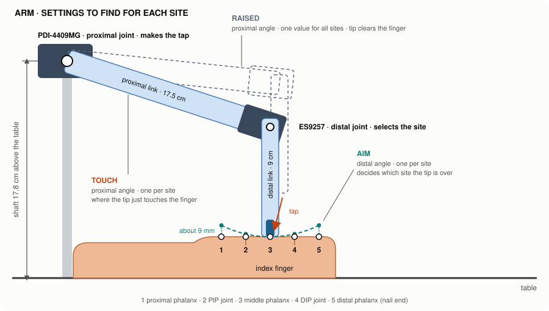
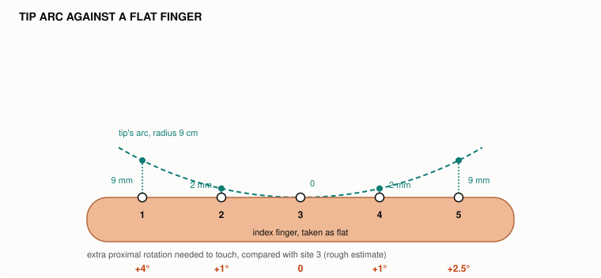

# Arm geometry and site angles

Fill in during roadmap step 3.2. Photograph the arm at each site and save the
images in `docs/figures/`.



**Since 2026-11-25 the sites are taught by contact, per hand: see
[`site-calibration.md`](site-calibration.md).** Two pulses per site are
taught, **AIM** (distal) and **CONTACT** (proximal), and RAISED and TOUCH are
computed from CONTACT with the shared constants S and P. This file keeps the
arm's fixed geometry (links, wiring, ZERO poses, limits) and the earlier
four-site measurements, which are superseded.

Pulses are recorded in microseconds first: a pulse is exactly what the servo
receives, whereas an angle depends on where the horn happens to sit on its
splined shaft. Degrees are optional (see the note under the tables).

Date: 2026-11-24 (bench session started)
Link lengths: proximal 175 mm (19 mm wide); distal 112.1 mm in total, including
the 30 mm rubber tip tube (measured 2026-11-24). Before the tube was fitted the
distal link was 90 mm; PROJECT.md 1.2 and the figures still say 90 mm and are to
be updated.
Base position relative to hand:

## Wiring (decided 2026-11-23)

| Arm | Joint | Servo | Teensy pin | Pulse rate |
|---|---|---|---|---|
| top | proximal | PDI-4409MG | 3 | 333 Hz |
| top | distal | EMAX ES9257 | 6 | 100 Hz |
| down | proximal | PDI-4409MG | 2 | 333 Hz |
| down | distal | EMAX ES9257 | 9 | 100 Hz |

Each signal goes through a 1 kohm resistor until the 74AHCT125 arrives. Pins 2
and 3 are the A and B channels of one hardware PWM timer, and pins 6 and 9 are
the A and B channels of another (read from the pin table in the Teensy core).
Pins on one timer share a frequency, so the PDIs can run at 333 Hz and the
EMAXes at 100 Hz (the EMAX buzzes at 200 Hz and above, see
`servo-characterisation.md`). Not yet verified on the logic analyser: expect a
3.00 ms period on pins 2 and 3, and 10.0 ms on pins 6 and 9.

## Limits carried over from step 3.1

- EMAX operating range 900-1900 us. It shakes slightly at 1200 us, so avoid
  that pulse for a site.
- The five sites need about 53 degrees of distal sweep, which is about 550 us
  at the EMAX's 0.0956 degrees per us. Turn the horn on its spline so the five
  AIM pulses fall in the clean part, roughly 1250-1800 us.
- The jog program limits the PDI to 600-1830 us: the top is the ZERO below, and
  the floor is inside the 500-2500 us measured. Narrow the floor once the arm's
  real safe swing is known.

## ZERO poses (2026-11-24)

Each joint has a ZERO pulse: the pose every trial starts from, and a ceiling the
joint is never commanded above. Fewer microseconds move the joint DOWN.

| Joint | ZERO | Notes |
|---|---|---|
| top proximal (PDI, pin 3) | 1830 us | link level, checked with a level |
| down proximal (PDI, pin 2) | 1830 us | link level, checked with a level |
| top distal (EMAX, pin 6) | 1900 us (decided, horn not yet fitted) | a few degrees below horizontal |
| down distal (EMAX, pin 9) | 1860 us (decided, horn not yet fitted) | a few degrees below horizontal, about 4 degrees further than the top arm |

- The proximal horns were fitted with the pulse held at 1800 us, then trimmed up
  by 30 us (about 2.8 degrees at 0.093 degrees per us) until a level read 0.
- Direction, checked on the bench: 1780 us drops the proximal arm and 1830 us
  raises it, so fewer microseconds is down.
- Ceiling: the jog program refuses any proximal pulse above 1830 us. It is a
  software limit only; there is no physical stop, to keep the EMAX gears away
  from hard stops.
- Smallest visible step on the proximal arm, judged by eye: no motion at 1810 and
  1820 us (10 and 20 us from ZERO), motion at 1800 us (30 us, about 2.8
  degrees). This is the effective resolution under load, not a measured dead
  band. Approach every TOUCH pulse from above (descending), the direction the
  real tap travels, in case there is backlash.
- Distal plan: ZERO is 1900 us for the top arm and 1860 us for the down arm, with
  the link a few degrees below horizontal so that the farthest site (site 1) can
  be reached. The down arm starts 40 us (about 3.8 degrees) lower, so its link
  must sit about 4 degrees further below horizontal than the top arm's for site 1
  to stay above the 900 us floor. Each horn is fitted at its ZERO pulse; then
  check that site 1 is reachable at 900 us or more, aiming for about 950 us (the
  EMAX is unreliable at the ends of its range). If it is not, refit the horn one
  tooth over.
- The jog program caps the EMAXes at their ZERO: 1900 us (top) and 1860 us (down).

## Site mapping (2026-11-24): superseded

**Superseded on 2026-11-25.** Deviation D6 is withdrawn (PROJECT.md 1.13):
the five anatomical sites of Chancel et al. are kept and taught by contact on
each hand ([`site-calibration.md`](site-calibration.md)). The four-site
mapping and the tables below are kept as the record of the 2026-11-24 bench
session; `arm_taps` no longer uses them.

Chancel et al. use five sites on the index finger (PROJECT.md 1.4). The
2026-11-24 session used FOUR, about 13.3 mm apart, the same four on both arms.

| Site | Location, as given on 2026-11-24 |
|---|---|
| 1 | the MCP joint: the articulation between the metacarpal and the proximal phalanx |
| 2 | between site 1 and site 3 |
| 3 | between site 2 and site 4 |
| 4 | the last site; given as "the middle proximal phalanx joint", to be confirmed |

On both arms the distal AIM pulse falls as the site number rises (top arm 1260,
1200, 1130 and 1080 us; down arm 1380, 1290, 1210 and 1130 us), so fewer
microseconds moves the tip from site 1 toward site 4.

Arm roles (decided 2026-11-24): the top arm taps the rubber hand (arm index 1)
and the down arm taps the real hand (arm index 0). With t_rubber = t_real +
delta, a positive delta means the real hand, the down arm, is touched first.

## Per-site settings (2026-11-24, four sites, superseded)

Four sites, numbered from the MCP joint (see "Site mapping" above). Both arms
were measured on 2026-11-24 with the arm_jog key mode at a step of 10 us, each
TOUCH reached by descending (keys s or b), so it is approached from above. The
figure `figures/arm-site-angles.svg` still shows the original five-site layout
(2 cm apart) and is out of date; redo it once RAISED is measured.

### Top arm, rubber hand (PDI on pin 3, EMAX on pin 6)

RAISED, proximal pulse (same for all sites): not yet measured (ZERO is 1830 us)

| Site | Location | AIM: distal pulse (us) | AIM angle (deg, optional) | TOUCH: proximal pulse (us) | TOUCH angle (deg, optional) |
|---|---|---|---|---|---|
| 1 | MCP joint | 1260 | | 1620 | |
| 2 | between sites 1 and 3 | 1200 | | 1610 | |
| 3 | between sites 2 and 4 | 1130 | | 1590 | |
| 4 | last site | 1080 | | 1590 | |

### Down arm, real hand (PDI on pin 2, EMAX on pin 9)

RAISED, proximal pulse (same for all sites): not yet measured (ZERO is 1830 us)

| Site | Location | AIM: distal pulse (us) | AIM angle (deg, optional) | TOUCH: proximal pulse (us) | TOUCH angle (deg, optional) |
|---|---|---|---|---|---|
| 1 | MCP joint | 1380 | | 1600 | |
| 2 | between sites 1 and 3 | 1290 | | 1600 | |
| 3 | between sites 2 and 4 | 1210 | | 1600 | |
| 4 | last site | 1130 | | 1590 | |

**About the degree columns.** For the EMAX, a provisional conversion is
`angle = 102.8 - 0.0943 x (pulse - 1450)` (protractor convention, from
`servo-characterisation.md`; the angle falls as the pulse grows). For the PDI,
the angle at a given pulse depends on where the horn was fitted, so measure it
from the horizontal with a level instead of reusing the step 3.1 protractor
numbers. The sign convention for the real arm is set in the servo driver
(step 3.3).

**Raw log.** Paste the `MARK` lines from the jog program here, one per
settled pose, so every number above can be traced:

```
MARK zero_top_prox top_prox=1830 top_dist=1800 down_prox=1830 down_dist=off
MARK zero_down_prox top_prox=1830 top_dist=1800 down_prox=1830 down_dist=off
Key-mode reports as sent on 2026-11-24 (targets, not MARK lines):
top  site 1  prox=1620  dist=1260  step=10us
top  site 2  prox=1610  dist=1200  step=10us
top  site 3  prox=1590  dist=1130  step=10us
top  site 4  prox=1590  dist=1080  step=10us
down site 1  prox=1600  dist=1380  step=10us
down site 2  prox=1600  dist=1290  step=10us
down site 3  prox=1600  dist=1210  step=10us
down site 4  prox=1590  dist=1130  step=10us
(paste further MARK lines here)
```

Photographs: save in `docs/figures/` and list them here: ___

## Arc compensation check

Predicted height variation across sites (sagitta, see PROJECT.md 2.2): ~9 mm
(90 mm distal link sweeping an ~80 mm finger chord: 80² / (8 × 90) = 8.9 mm).
With the 112.1 mm distal link now fitted this becomes 80² / (8 × 112.1) = 7.1 mm;
the table below still uses the 90 mm figures and is to be redone.



Predicted extra proximal rotation to touch, compared with site 3. Assumes a
flat finger, the arm near horizontal and site 1 nearest the base:

| Site | 1 | 2 | 3 | 4 | 5 |
|---|---|---|---|---|---|
| Arc gap above the finger (mm) | 9.4 | 2.2 | 0 | 2.2 | 9.4 |
| Extra rotation (deg) | +4.0 | +0.8 | 0 | +0.7 | +2.5 |
| Same in PDI pulse (us, at 0.093 deg per us) | about 43 | about 9 | 0 | about 7 | about 27 |

How the estimate is made: lowering the tip by the gap g needs a proximal
rotation of g divided by the horizontal distance from the proximal shaft to the
tip. That distance is about 13.5 cm at site 1 and 21.5 cm at site 5 (17.5 cm
link plus or minus the tip's offset along the finger). Site 1: 9.4 mm / 135 mm
= 0.070 rad = 4.0 deg. Site 5: 9.4 mm / 215 mm = 0.044 rad = 2.5 deg. A real
finger is not flat, so expect the measured numbers to differ; that is the
reason to measure them.

Observed spread in proximal TOUCH pulses, largest minus smallest: top arm 30 us
(about 2.8 deg), down arm 10 us (about 0.9 deg), at 0.093 deg per us.
